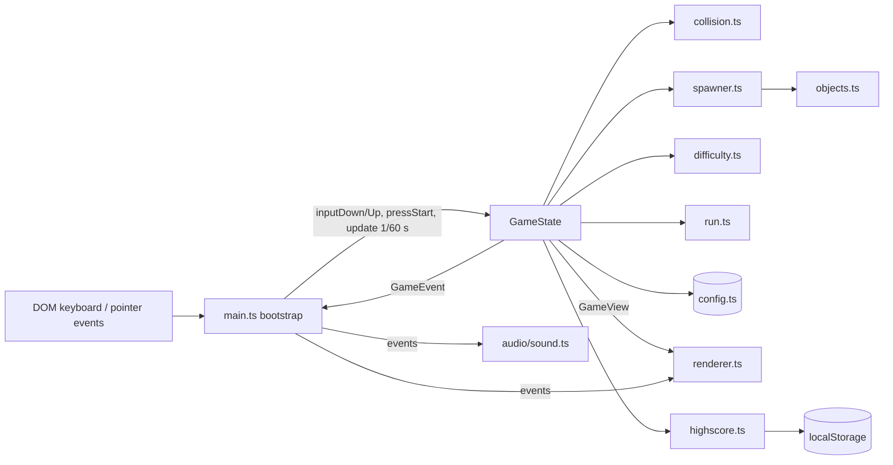
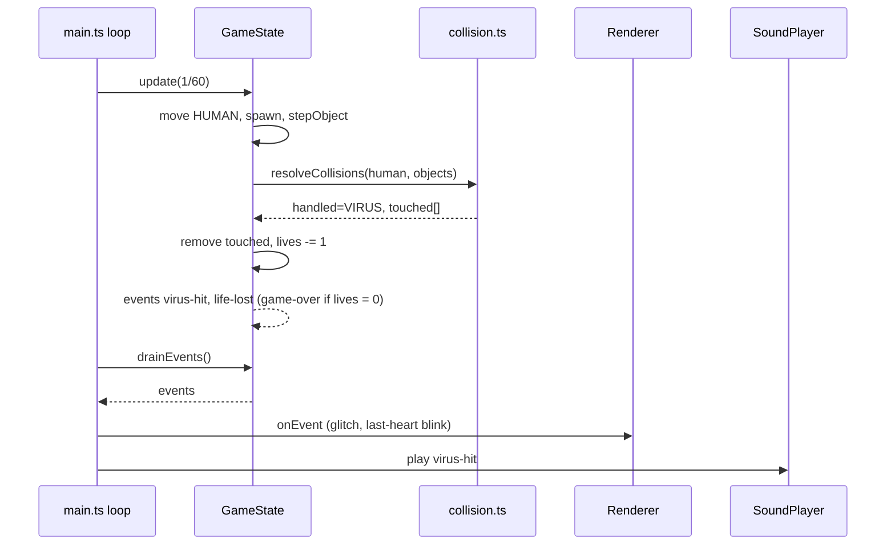
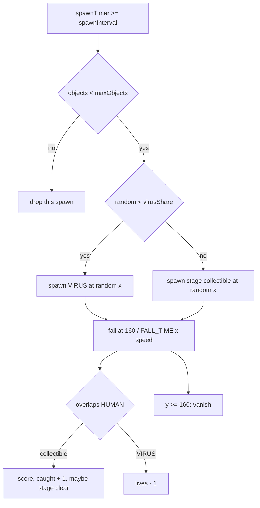

# Architecture Analysis

## System Overview
A single-page, client-only TypeScript game. `src/main.ts` wires DOM input, a fixed-step loop, a pure game-rules class (`GameState`), a Canvas renderer, and a Web Audio sound player. There is no backend.

## Architectural Style
Monolithic browser app with a strict logic/render split: `src/game/` has no DOM, canvas, or audio code (`state.ts:41-45` comment, imports in dependencies.md). The renderer reads a `GameView`; the sound player and renderer react to drained `GameEvent`s.

## Component Relationships

Text fallback: DOM events enter `main.ts`; it drives `GameState.update(1/60)`. `GameState` uses collision, spawner/objects, difficulty, run, and config, and publishes a `GameView` (read by the renderer) and `GameEvent`s (drained by `main.ts` and sent to the renderer effects and the sound player). High scores go through `HighScoreStore` to localStorage.

## Data Flow
1. `main.ts` frame loop accumulates real time (capped at 0.25 s per frame, `main.ts:10,141`) and calls `state.update(1/60)` per step (`main.ts:9,144-149`).
2. `updatePlaying` (`state.ts:247-273`): add `stageTime`; move HUMAN; spawn; move objects; resolve collisions; remove objects below the area.
3. Events are drained, drawn as effects, and mapped to sounds.

## Game Rules: Current Values (precise, for the active intent)

### Play area and HUMAN
| Item | Value | Source |
|---|---|---|
| Play area | 240 x 160 logical px | `config.ts:5-6` |
| HUMAN size / hit box | 20 x 20 (hit box = full size) | `config.ts:11-12`, `state.ts:53` |
| HUMAN position | x starts at 110 (centered), y fixed at 140 (occupies y 140-160) | `state.ts:53`, `state.ts:186` |
| HUMAN speed | 130 px/s, no acceleration; full-width travel (220 px) takes about 1.69 s | `config.ts:14`, `state.ts:251` |
| Input | last-pressed held direction wins; clamped to [0, 220] | `input.ts:27-33`, `state.ts:251` |
| Objects | 16 x 16 hit box for every kind | `config.ts:9-10`, `objects.ts:52-53` |

### Phase timing
Intro 2.0 s (no spawning, no movement), clear 2.5 s, victory 3.5 s, game-over 2.0 s (`config.ts:40-43`, `state.ts:145-156`). `stageTime` and `spawnTimer` reset to 0 at each stage intro (`state.ts:183-184`) and count only during `playing` (`state.ts:248`). So the first spawn of a stage happens `spawnInterval` seconds after play begins, i.e. 2.0 s + interval after START press for Stage 1 (3.2 s).

### Fall times and speeds (vy = 160 / FALL_TIME x fallSpeedMultiplier, `objects.ts:58`)
| Kind | FALL_TIME (s) | Base vy (px/s) | Source |
|---|---|---|---|
| mainframe, tape, floppy, llm | 4.0 | 40.0 | `config.ts:17-25` |
| robot | 3.5 | 45.7 (+ sway amplitude 22 px, period 1.6 s) | `config.ts:21`, `config.ts:108-109`, `objects.ts:68-72` |
| virus | 3.0 | 53.3 (+ jitter, amplitude 16 px) | `config.ts:23`, `config.ts:110`, `objects.ts:73-78` |
| gpu | 2.5 | 64.0 | `config.ts:24` |

Time for an object to reach the HUMAN hit band (object y > 124, i.e. 16 px box overlapping y 140): `124 / vy`; it leaves the band at y >= 160 (`objects.ts:86-88`), so the band is 36 px deep.
- Stage 1 start (multiplier 1.0): VIRUS 2.33 s after spawn, in band 0.68 s; collectible 3.10 s.
- Stage 2 start (1.1): VIRUS 2.11 s. Stage 3 start (1.2): 1.94 s. Stage 4 start (1.3): 1.79 s.
- Stage 1 cap (1.2): VIRUS 1.94 s.

### Spawning and difficulty (`config.ts:57-59`, `config.ts:68-105`, `difficulty.ts:12-23`, `spawner.ts:12-34`, `state.ts:253-263`)
Difficulty changes in discrete steps: `n = floor(stageTime / 8)`, capped at 4 steps; values interpolate linearly start to cap by `n/4`. `maxObjects` is floored. A spawn is skipped (timer still consumed) when `objects.length >= maxObjects` (`state.ts:258`). Spawn x is uniform over [0, 224] (`spawner.ts:31`); kind is VIRUS with probability `virusShare` (first random draw), otherwise collectibles in equal parts (`spawner.ts:17-20`).

| Stage | Speed x (start / cap) | Spawn interval s (start / cap) | VIRUS share (start / cap) | Max objects (start / cap) | Required catches | VIRUS per s at start |
|---|---|---|---|---|---|---|
| 1 FORTRAN | 1.0 / 1.2 | 1.2 / 1.0 | 0.10 / 0.15 | 3 / 4 | 10 | 0.083 (1 per 12 s) |
| 2 COBOL | 1.1 / 1.35 | 1.1 / 0.9 | 0.15 / 0.22 | 4 / 5 | 12 | 0.136 |
| 3 BASIC | 1.2 / 1.5 | 1.0 / 0.8 | 0.20 / 0.28 | 4 / 5 | 14 | 0.200 |
| 4 LLM | 1.3 / 1.7 | 0.9 / 0.7 | 0.25 / 0.35 | 5 / 6 | 16 | 0.278 |

Stage 1 intermediate steps (8 s, 16 s, 24 s, 32 s): speed 1.05/1.10/1.15/1.20, interval 1.15/1.10/1.05/1.00, VIRUS share 0.1125/0.125/0.1375/0.15, max objects 3/3/3/4 (floor of 3.25, 3.5, 3.75, 4.0). So the first 8 s of play always use the start values.

### Collision and VIRUS hit (`collision.ts:9-43`, `state.ts:267-294`)
- Overlap is strict AABB: `a.x < b.x+b.w && a.x+a.w > b.x && a.y < b.y+b.h && a.y+a.h > b.y`. Touching edges do not count. Horizontal overlap window for one VIRUS against a stationary HUMAN is 36 px (-16 < dx < 20).
- All touching objects are removed in the same update; only one (`handled`) is processed: VIRUS first, otherwise the earliest-spawned. Consequences: two VIRUS in one update cost one life; a collectible touched in the same update as a VIRUS is removed without scoring.
- VIRUS hit: `lives = max(0, lives - 1)`, emit `virus-hit` then `life-lost`; at 0 lives `enterGameOver` (clears objects). Score is not reduced. There is no invulnerability or grace period: the touched VIRUS is removed, but other objects stay and can hit on the next update.
- Feedback: glitch 0.45 s, last-heart blink 1.0 s, synthesized "virus-hit" cue (`renderer.ts:96-98,126-131`, `audio/sound.ts:86-90`). The effects do not change gameplay.
- Objects reaching the bottom (`y >= 160`) vanish with no penalty (`state.ts:271-272`).
- START_LIVES = 3 (`config.ts:37`), applied at `startRun` and `returnToTitle` (`state.ts:172,238`); lives carry across stages (no refill, `tests/game/state.test.ts:236`).

## Key Design Decisions
- All tunables in `config.ts` with requirement IDs in comments; difficulty is data-driven per stage (start and cap).
- Deterministic fixed-step update with injectable `Random` for tests (`state.ts:36-39`, `spawner.ts:6`).
- Pure display helpers in `render/screen-timing.ts` so they run without a canvas.

## Improvement Opportunities
- Difficulty "first contact" timing is controlled by only a few config numbers (spawn interval, VIRUS share, speed, max objects); see code-quality-assessment.md "Intent Findings".
- `renderer.ts` (486 lines) mixes layout and effects; not touched by this intent.

## Interaction Diagrams

### VIRUS hit during play

Text fallback: each step the loop calls `update`; `GameState` moves HUMAN, spawns, moves objects, asks `resolveCollisions` for the handled object; for a VIRUS it removes all touched objects, decrements lives, queues `virus-hit` and `life-lost` (and `game-over` at 0). The loop then drains events and sends them to the renderer and sound player.

### Spawn to catch

Text fallback: when the spawn timer reaches the interval, the spawn is dropped if the screen is full; otherwise a VIRUS (by share) or a collectible appears at a random x and falls. Contact with HUMAN scores a collectible or costs a life for a VIRUS; objects reaching the bottom vanish.
