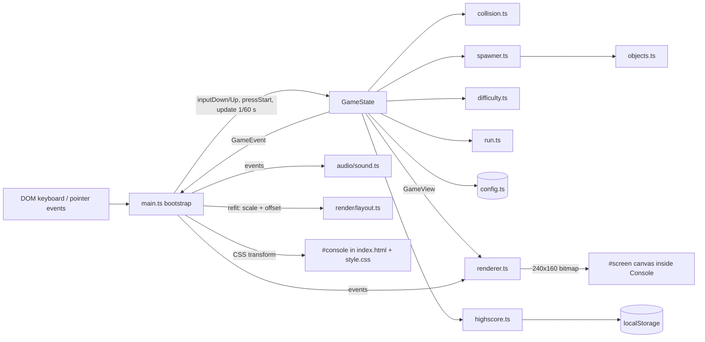
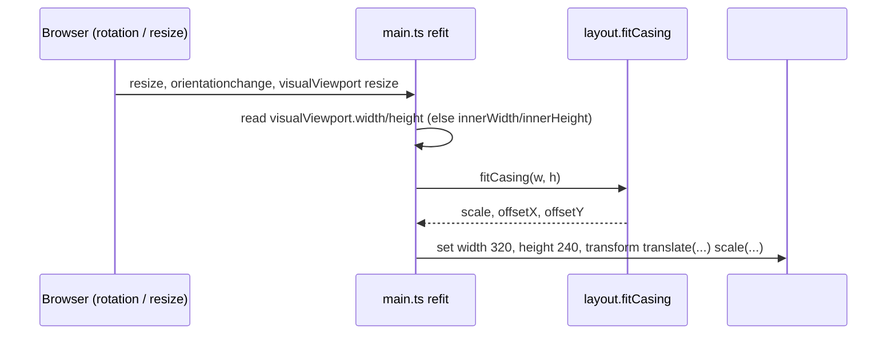
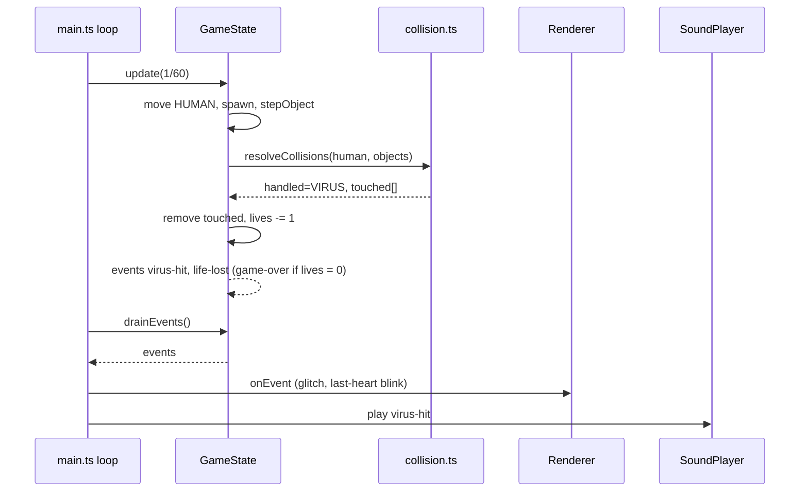
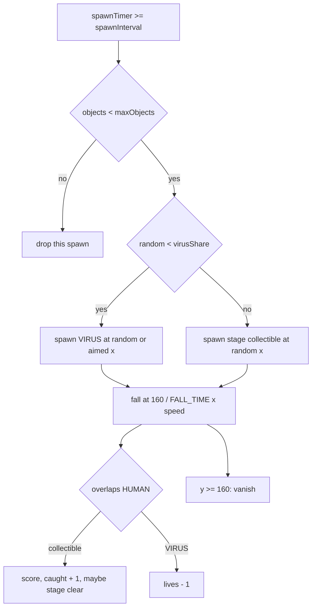
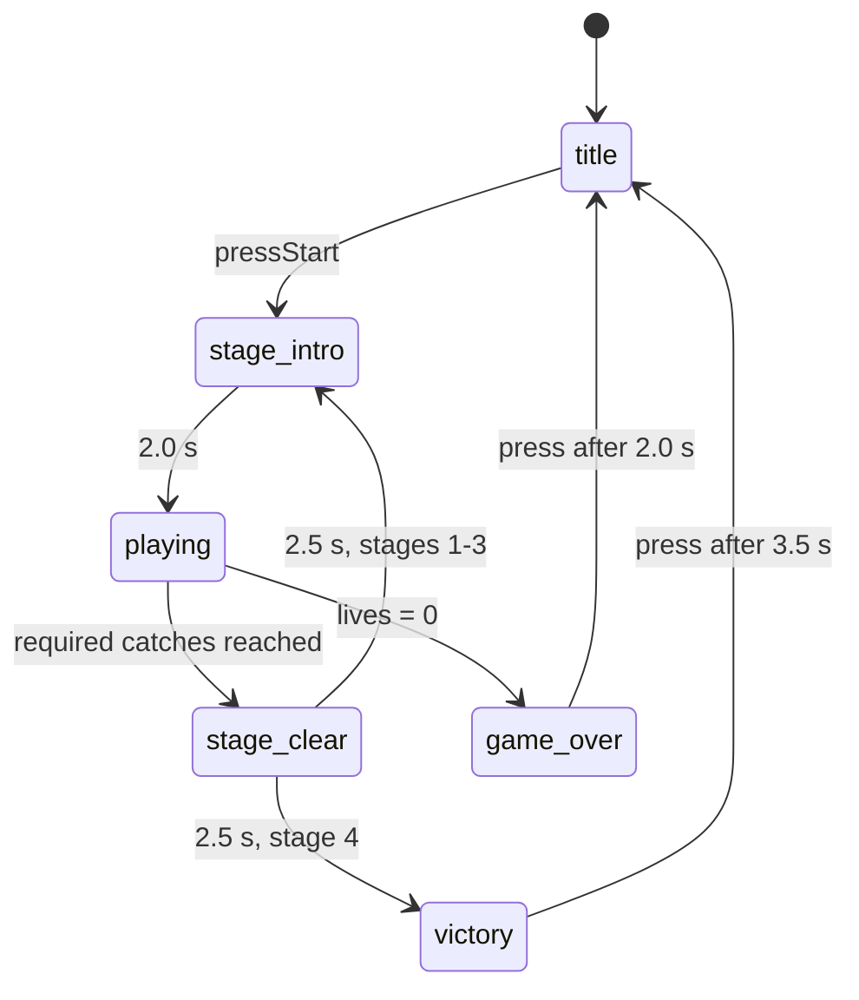

# Architecture Analysis
## System Overview
A single-page, client-only TypeScript game. `src/main.ts` wires DOM input, a fixed-step loop, a pure game-rules class (`GameState`), a Canvas renderer, and a Web Audio sound player. There is no backend.
## Architectural Style
Monolithic browser app with a strict logic/render split: `src/game/` has no DOM, canvas, or audio code (`state.ts:42-46` comment, imports in dependencies.md). The renderer reads a `GameView`; the sound player and renderer react to drained `GameEvent`s.
## Component Relationships

Text fallback: DOM events enter `main.ts`; it drives `GameState.update(1/60)`. `GameState` uses collision, spawner/objects, difficulty, run, and config, and publishes a `GameView` (read by the renderer) and `GameEvent`s (drained by `main.ts` and sent to the renderer effects and the sound player). High scores go through `HighScoreStore` to localStorage. Separately, `main.ts` asks `layout.ts` for a scale and offset and applies them as a CSS transform on `#console`, which holds the 240x160 canvas that the renderer draws.
## Responsive Layout and Orientation (this run, `src/main.ts`, `src/render/layout.ts`, `src/style.css`, `index.html`)
### Coordinate spaces
| Space | Size | Defined at |
|---|---|---|
| Game (logical) | 240 x 160, drives physics, objects, HUMAN | `src/game/config.ts:5-6` |
| Canvas bitmap | 240 x 160 (attributes, never resized by script) | `index.html:20-21`; `renderer.ts:116-118` (no `setTransform`, no DPR) |
| Canvas CSS box | 240 x 160 CSS px inside the 260 x 180 bezel (padding 10) | `style.css:52-72` |
| Casing (`#console`) | 320 x 240 CSS px, absolutely placed at left 0, top 0 | `style.css:25-37`, `layout.ts:2-3`, `main.ts:42-43` |
| Viewport | `visualViewport` width/height, else `innerWidth/innerHeight` | `main.ts:38-40` |
| Touch input | `clientX` against `window.innerWidth / 2` | `main.ts:96` |
The game space maps to screen only through one CSS transform on `#console`: `translate(offsetX, offsetY) scale(s)` with origin `0 0` (`main.ts:44`, `style.css:31`). `s = min(vw / 320, vh / 240)` with no rounding, offsets centre the result (`layout.ts:21-34`).
### Refit flow

Text fallback: three listeners (`main.ts:47-49`) call `refit` synchronously; it reads the visual viewport size, asks `fitCasing` for scale and offsets, and writes the CSS transform. The first call runs at start (`:46`). Nothing re-reads the size after layout settles, and `visualViewport.scroll` is not listened to.
### Touch flow
```mermaid
sequenceDiagram
  participant F as Finger
  participant W as window pointerdown
  participant S as GameState
  F->>W: pointerdown (clientX)
  W->>W: skip if target is inside a button; mouse gives direction-less press
  W->>S: inputDown(touch:id, clientX < innerWidth/2 ? -1 : 1)
  F->>W: pointerup / pointercancel
  W->>S: inputUp(touch:id)
```
Text fallback: a touch pointerdown outside any button registers a held direction chosen once by comparing `clientX` with half of `window.innerWidth` (`main.ts:87-100`); release clears it (`:101-106`). The direction is never recomputed while the finger is held, and the canvas or casing position is not consulted.
### Findings
The candidate defects with line references are recorded once in code-quality-assessment.md "Intent Findings: orientation and scaling".
## Data Flow
1. `main.ts` frame loop accumulates real time (capped at 0.25 s per frame, `main.ts:10,141`) and calls `state.update(1/60)` per step (`main.ts:9,144-149`). The loop is not paused by resize or rotation (`main.ts:137`).
2. `update` adds dt to `phaseTime` (`state.ts:144`) and dispatches by phase (`:145-160`). `updatePlaying` (`state.ts:249-282`): add `stageTime`; move HUMAN; spawn; move objects; resolve collisions and handle one object; remove objects below the area.
3. Events are drained, drawn as effects, and mapped to sounds.
## Game Rules: Current Values (carried over, `src/game` not re-analyzed in this run)
These values are from the prior store (commit `c41d919`). Commit `a48cb16` changed `src/game/config.ts`, `state.ts`, `spawner.ts`, `types.ts`: it added `STAGE_TIME_LIMIT = 90`, `TIME_WARNING_SECONDS = 10`, `TIME_BONUS_PER_SECOND = 10`, a per-stage `collectibleSpeedFactor` (`config.ts:111-117`, `:77,87,97`), and harder Stage 2-4 values (for example Stage 4 cap multiplier 1.8, interval 0.68, VIRUS share 0.62). Re-verify the numbers below against `config.ts` before relying on them. None of this affects orientation work.
### Play area and HUMAN
| Item | Value | Source |
|---|---|---|
| Play area | 240 x 160 logical px | `config.ts:5-6` |
| HUMAN size / hit box | 20 x 20 (hit box = full size) | `config.ts:11-12`, `state.ts:54` |
| HUMAN position | x starts at 110 (centered), y fixed at 140 (occupies y 140-160) | `state.ts:54`, `state.ts:188` |
| HUMAN speed | 130 px/s, no acceleration; full-width travel (220 px) takes about 1.69 s | `config.ts:14`, `state.ts:253` |
| Input | last-pressed held direction wins; clamped to [0, 220] | `input.ts:27-33`, `state.ts:253` |
| Objects | 16 x 16 hit box for every kind | `config.ts:9-10`, `objects.ts:52-53` |
### Phase timing and run end
Intro 2.0 s (no spawning, no movement), clear 2.5 s, victory 3.5 s, game-over 2.0 s (`config.ts:40-43`, `state.ts:145-160`). The phase machine is title -> stage-intro -> playing -> stage-clear -> (next stage-intro | victory); game-over was entered only from `playing` (`state.ts:226-232`, called at `:300`; a time-out path was added in `a48cb16`).
- `phaseTime` (public, in `GameView`, `state.ts:50`, `types.ts:40`) counts seconds since the current phase began and resets to 0 when `playing` starts (`state.ts:148-150`).
- `stageTime` (private, `state.ts:62`) is reset at each stage intro (`:184`) and accumulates only in `updatePlaying` (`:250`). It feeds `difficultyAt`. `spawnTimer` is initialised to `spawnInterval - FIRST_SPAWN_DELAY` (`:186`), so the first spawn is 0.5 s after play begins.
- Victory: a catch that reaches `requiredCount` on Stage 4 sets `run.complete` (`run.ts:31`); `clearStage` adds the bonus and enters `stage-clear` (`state.ts:193-205`); after 2.5 s `finishStageClear` enters `victory` (`:207-223`).
- Events (`types.ts:65-73`): `run-start`, `stage-start`, `catch`, `virus-hit`, `life-lost`, `stage-clear`, `victory`, `game-over`. A VIRUS hit pushes `virus-hit` then `life-lost`, then `game-over` at 0 lives.
### Fall times and speeds (vy = 160 / FALL_TIME x fallSpeedMultiplier, `objects.ts:58`)
| Kind | FALL_TIME (s) | Base vy (px/s) | Source |
|---|---|---|---|
| mainframe, tape, floppy, llm | 4.0 | 40.0 | `config.ts:17-25` |
| robot | 3.5 | 45.7 (+ sway amplitude 22 px, period 1.6 s) | `config.ts:22`, `config.ts:115-116`, `objects.ts:68-72` |
| virus | 2.2 | 72.7 (+ jitter, amplitude 16 px) | `config.ts:23`, `config.ts:117`, `objects.ts:73-78` |
| gpu | 2.5 | 64.0 | `config.ts:24` |
Time for an object to reach the HUMAN hit band (object y > 124, i.e. 16 px box overlapping y 140): `124 / vy`; it leaves the band at y >= 160 (`objects.ts:86-88`), so the band is 36 px deep.
### Spawning and difficulty (`difficulty.ts:12-23`, `spawner.ts:12-45`, `state.ts:255-272`; stage values changed in `a48cb16`)
Difficulty changes in discrete steps: `n = floor(stageTime / 8)`, capped at 4 steps; values interpolate linearly start to cap by `n/4`; the cap is reached at 32 s of play in a stage. `maxObjects` is floored. A spawn is skipped (timer still consumed) when `objects.length >= maxObjects` (`state.ts:260`). Spawn x is uniform over [0, 224] (`spawner.ts:42`); kind is VIRUS with probability `virusShare`, otherwise collectibles in equal parts. A VIRUS is aimed at HUMAN's centre (plus or minus `VIRUS_AIM_SPREAD` 20 px) with probability `VIRUS_AIM_SHARE` 1/3.
Stage 1-4 start/cap tables from `c41d919` (prior store) are superseded by `config.ts` at `a48cb16` and are not repeated here; read `src/game/config.ts:68-110` for current values.
### Collision and VIRUS hit (`collision.ts:9-43`, `state.ts:276-304`)
- Overlap is strict AABB: touching edges do not count. Horizontal overlap window for one VIRUS against a stationary HUMAN is 36 px (-16 < dx < 20).
- All touching objects are removed in the same update; only one (`handled`) is processed: VIRUS first, otherwise the earliest-spawned. Two VIRUS in one update cost one life.
- VIRUS hit: `lives = max(0, lives - 1)`, emit `virus-hit` then `life-lost`; at 0 lives `enterGameOver`. Score is not reduced. No invulnerability.
- Objects reaching the bottom (`y >= 160`) vanish with no penalty (`state.ts:280-281`).
- START_LIVES = 3 (`config.ts:37`), applied at `startRun` and `returnToTitle`; lives carry across stages.
## HUD Layout (`renderer.ts:220-262`, current at `a48cb16`)
```
x: 0        34       66            108       132 (timer "T n")      202   228  240
   FORTRAN  AI 100%  [score 6 dig] 16/16     T 90                   <3><3><3>
y: 4 (text) / 3-11 (seven-segment digits); rule at y=14; floor line at y=159
```
HUD x positions are logical 240-px coordinates inside the canvas, so they do not depend on viewport size or orientation (`renderer.ts:71-75`, `HUD_TIMER_X = 132`). Text width at scale 1 is `4 x chars - 1` px. The timer is drawn only when `timerVisible` (`screen-timing.ts`, blinks in the last 10 s). All HUD, START prompt and game-over text are drawn on the canvas; the only DOM controls are the START button and the MOVE hint in `.controls` (`index.html:25-28`).
## Key Design Decisions
- All tunables in `config.ts` with requirement IDs in comments; difficulty is data-driven per stage (start and cap).
- Deterministic fixed-step update with injectable `Random` for tests (`state.ts:37-40`, `spawner.ts:6`).
- Pure display helpers in `render/screen-timing.ts` so they run without a canvas.
- One fixed logical casing (320 x 240) scaled as a whole by a CSS transform (`main.ts:44`); the canvas bitmap stays 240 x 160 and is never resized or DPR-adjusted (`index.html:20-21`).
- Touch has no on-screen buttons: half-window left/right (`main.ts:96`), so there are no per-button hit rectangles to recompute on rotation.
## Improvement Opportunities
- Layout inputs (viewport source, offsets, rounding, minimum size) could live in the pure `fitCasing` so they are testable under Vitest's node environment (`layout.ts:21`); see code-quality-assessment.md.
- `renderer.ts` (493 lines) mixes layout and effects.
## Interaction Diagrams
### Rotation refit and touch (see "Responsive Layout and Orientation" above)
The refit flow and touch flow diagrams in that section are the interaction diagrams for this intent.
### VIRUS hit during play

Text fallback: each step the loop calls `update`; `GameState` moves HUMAN, spawns, moves objects, asks `resolveCollisions` for the handled object; for a VIRUS it removes all touched objects, decrements lives, queues `virus-hit` and `life-lost` (and `game-over` at 0). The loop then drains events and sends them to the renderer and sound player.
### Spawn to catch

Text fallback: when the spawn timer reaches the interval, the spawn is dropped if the screen is full; otherwise a VIRUS (by share) or a collectible appears at a random (or HUMAN-aimed, for one third of VIRUS) x and falls. Contact with HUMAN scores a collectible or costs a life for a VIRUS; objects reaching the bottom vanish.
### Phase flow and run end (at `c41d919`; a time-out exit from playing to game-over was added in `a48cb16`)

Text fallback: the run goes title, stage-intro (2.0 s), playing. From playing it leaves by clearing the stage (stage-clear, 2.5 s, then the next intro or victory after Stage 4) or by losing the last life (game-over). Game-over and victory return to the title on a new press after 2.0 s and 3.5 s.
