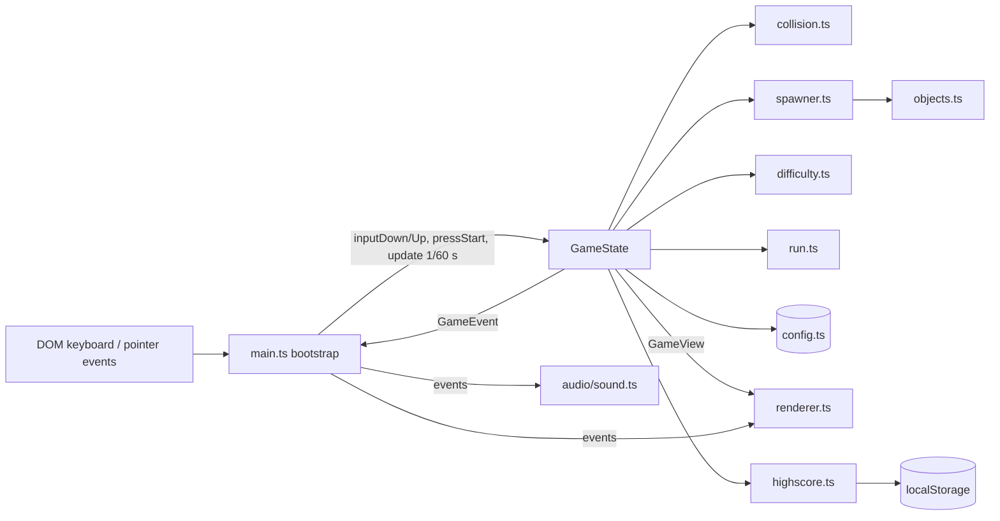
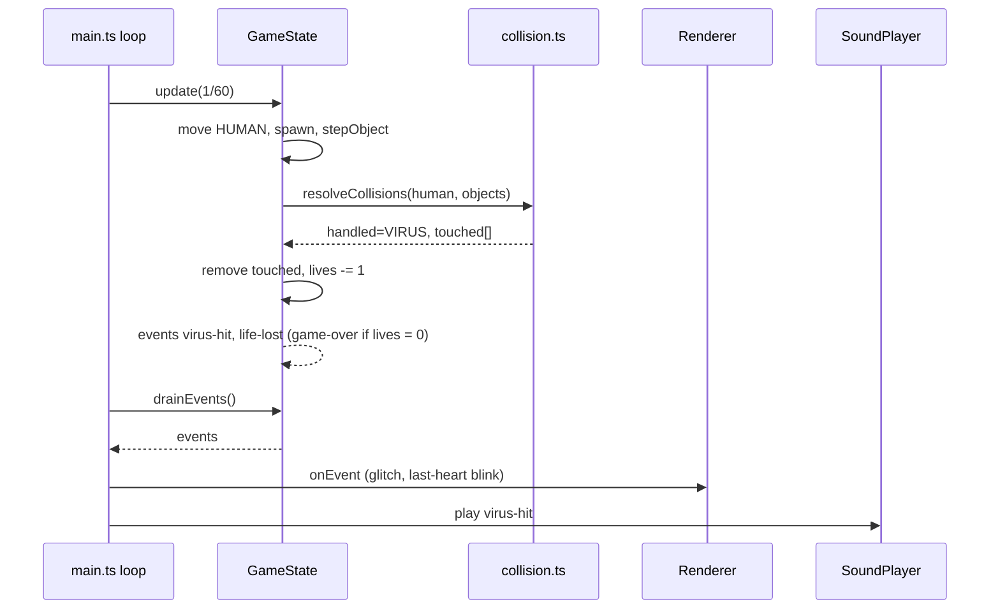
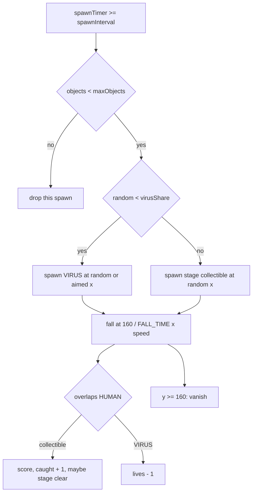
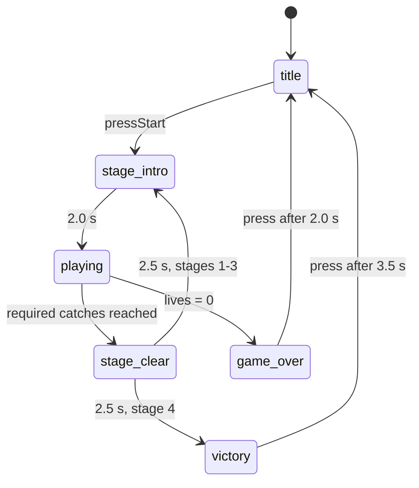

# Architecture Analysis
## System Overview
A single-page, client-only TypeScript game. `src/main.ts` wires DOM input, a fixed-step loop, a pure game-rules class (`GameState`), a Canvas renderer, and a Web Audio sound player. There is no backend.
## Architectural Style
Monolithic browser app with a strict logic/render split: `src/game/` has no DOM, canvas, or audio code (`state.ts:42-46` comment, imports in dependencies.md). The renderer reads a `GameView`; the sound player and renderer react to drained `GameEvent`s.
## Component Relationships

Text fallback: DOM events enter `main.ts`; it drives `GameState.update(1/60)`. `GameState` uses collision, spawner/objects, difficulty, run, and config, and publishes a `GameView` (read by the renderer) and `GameEvent`s (drained by `main.ts` and sent to the renderer effects and the sound player). High scores go through `HighScoreStore` to localStorage.
## Data Flow
1. `main.ts` frame loop accumulates real time (capped at 0.25 s per frame, `main.ts:10,141`) and calls `state.update(1/60)` per step (`main.ts:9,144-149`).
2. `update` adds dt to `phaseTime` (`state.ts:144`) and dispatches by phase (`:145-160`). `updatePlaying` (`state.ts:249-282`): add `stageTime`; move HUMAN; spawn; move objects; resolve collisions and handle one object; remove objects below the area.
3. Events are drained, drawn as effects, and mapped to sounds.
## Game Rules: Current Values (precise, for the active intent)
### Play area and HUMAN
| Item | Value | Source |
|---|---|---|
| Play area | 240 x 160 logical px | `config.ts:5-6` |
| HUMAN size / hit box | 20 x 20 (hit box = full size) | `config.ts:11-12`, `state.ts:54` |
| HUMAN position | x starts at 110 (centered), y fixed at 140 (occupies y 140-160) | `state.ts:54`, `state.ts:188` |
| HUMAN speed | 130 px/s, no acceleration; full-width travel (220 px) takes about 1.69 s | `config.ts:14`, `state.ts:253` |
| Input | last-pressed held direction wins; clamped to [0, 220] | `input.ts:27-33`, `state.ts:253` |
| Objects | 16 x 16 hit box for every kind | `config.ts:9-10`, `objects.ts:52-53` |
### Phase timing and run end
Intro 2.0 s (no spawning, no movement), clear 2.5 s, victory 3.5 s, game-over 2.0 s (`config.ts:40-43`, `state.ts:145-160`). The phase machine is title -> stage-intro -> playing -> stage-clear -> (next stage-intro | victory); game-over is entered only from `playing` (`state.ts:226-232`, called at `:300`).
- `phaseTime` (public, in `GameView`, `state.ts:50`, `types.ts:40`) counts seconds since the current phase began and resets to 0 when `playing` starts (`state.ts:148-150`). So in `playing` it equals the in-stage play time.
- `stageTime` (private, `state.ts:62`) is reset at each stage intro (`:184`) and accumulates only in `updatePlaying` (`:250`). It feeds `difficultyAt` only (`:256`) and is not exposed in `GameView`. `spawnTimer` is initialised to `spawnInterval - FIRST_SPAWN_DELAY` (`:186`), so the first spawn is 0.5 s after play begins (`config.ts:108`).
- Game over: the only trigger is lives reaching 0 in `handle` (`state.ts:299-302`). `enterGameOver` (`:226-232`) sets phase `game-over`, resets `phaseTime`, clears objects, calls `highScore.submit(score)`, and pushes `{type:'game-over', score, newHighScore}` (no reason field, `types.ts:73`). Lives, caught, stage index and AI percent are kept and shown on the game-over screen.
- Victory: a catch that reaches `requiredCount` on Stage 4 sets `run.complete` (`run.ts:31`); `clearStage` adds the bonus and enters `stage-clear` (`state.ts:193-205`); after 2.5 s `finishStageClear` enters `victory` (`:207-223`), which submits the score and emits `victory`.
- The stage-clear catch returns from `updatePlaying` immediately (`state.ts:278,290-292`), so a time-out check placed after `stageTime += dt` must run after (or tie-break in favour of) the catch to avoid ending a run on the same update that clears the stage.
- Events (`types.ts:65-73`): `run-start`, `stage-start`, `catch`, `virus-hit`, `life-lost`, `stage-clear`, `victory`, `game-over`. A VIRUS hit pushes `virus-hit` then `life-lost` (`state.ts:297-298`), then `game-over` at 0 lives.
### Fall times and speeds (vy = 160 / FALL_TIME x fallSpeedMultiplier, `objects.ts:58`)
| Kind | FALL_TIME (s) | Base vy (px/s) | Source |
|---|---|---|---|
| mainframe, tape, floppy, llm | 4.0 | 40.0 | `config.ts:17-25` |
| robot | 3.5 | 45.7 (+ sway amplitude 22 px, period 1.6 s) | `config.ts:22`, `config.ts:115-116`, `objects.ts:68-72` |
| virus | 2.2 | 72.7 (+ jitter, amplitude 16 px) | `config.ts:23`, `config.ts:117`, `objects.ts:73-78` |
| gpu | 2.5 | 64.0 | `config.ts:24` |
Time for an object to reach the HUMAN hit band (object y > 124, i.e. 16 px box overlapping y 140): `124 / vy`; it leaves the band at y >= 160 (`objects.ts:86-88`), so the band is 36 px deep.
- VIRUS reaches the band at 1.71 s (x1.0, Stage 1 start), 1.55 s (x1.1, Stage 2 start), 1.42 s (x1.2), 1.31 s (x1.3, Stage 4 start), 1.26 s (x1.35, Stage 2 cap), 1.00 s (x1.7, Stage 4 cap). It stays in the band about 0.50 s at x1.0.
- A collectible (FALL_TIME 4.0) reaches the band at 3.10 s (x1.0), 2.82 s (x1.1), 2.38 s (x1.3).
- Test `config.test.ts:111-120` requires at least 1.5 s to react at Stage 1 start; with a x1.2 speed-up the value is 1.42 s.
### Spawning and difficulty (`config.ts:57-59`, `config.ts:68-105`, `difficulty.ts:12-23`, `spawner.ts:12-45`, `state.ts:255-272`)
Difficulty changes in discrete steps: `n = floor(stageTime / 8)`, capped at 4 steps; values interpolate linearly start to cap by `n/4`; the cap is reached at 32 s of play in a stage. `maxObjects` is floored. A spawn is skipped (timer still consumed) when `objects.length >= maxObjects` (`state.ts:260`). Spawn x is uniform over [0, 224] (`spawner.ts:42`); kind is VIRUS with probability `virusShare` (first random draw), otherwise collectibles in equal parts (`spawner.ts:17-20`). A VIRUS is aimed at HUMAN's centre (plus or minus `VIRUS_AIM_SPREAD` 20 px) with probability `VIRUS_AIM_SHARE` 1/3 (`config.ts:110-112`, `spawner.ts:36-41`).
| Stage | Speed x (start / cap) | Spawn interval s (start / cap) | VIRUS share (start / cap) | Max objects (start / cap) | Required catches | VIRUS per s (start / cap) | Collectibles per s (start / cap) |
|---|---|---|---|---|---|---|---|
| 1 FORTRAN | 1.0 / 1.2 | 1.2 / 1.0 | 0.40 / 0.45 | 3 / 4 | 10 | 0.333 / 0.450 | 0.500 / 0.550 |
| 2 COBOL | 1.1 / 1.35 | 1.1 / 0.9 | 0.45 / 0.50 | 4 / 5 | 12 | 0.409 / 0.556 | 0.500 / 0.556 |
| 3 BASIC | 1.2 / 1.5 | 1.0 / 0.8 | 0.50 / 0.55 | 4 / 5 | 14 | 0.500 / 0.688 | 0.500 / 0.563 |
| 4 LLM | 1.3 / 1.7 | 0.9 / 0.7 | 0.55 / 0.60 | 5 / 6 | 16 | 0.611 / 0.857 | 0.500 / 0.571 |
Source rows: `config.ts:69-77`, `:78-86`, `:87-95`, `:96-104`. Rates ignore spawns skipped at `maxObjects`.
- Because the collectible supply is about 0.5 per second in every stage, the minimum clear time with perfect catching is about `required / 0.5 + 0.5 s`: Stage 1 about 20 s, Stage 2 24 s, Stage 3 28 s, Stage 4 32 s. Within 90 s about 45-50 collectibles are supplied per stage, so the required counts are 12 of about 45 (27%) in Stage 2 and 16 of about 45 (36%) in Stage 4; the limit leaves slack for a competent player.
- Stage 1 intermediate steps (8 s, 16 s, 24 s, 32 s): speed 1.05/1.10/1.15/1.20, interval 1.15/1.10/1.05/1.00, VIRUS share 0.4125/0.425/0.4375/0.45, max objects 3/3/3/4 (floor of 3.25, 3.5, 3.75, 4.0). So the first 8 s of play always use the start values.
### Collision and VIRUS hit (`collision.ts:9-43`, `state.ts:276-304`)
- Overlap is strict AABB: `a.x < b.x+b.w && a.x+a.w > b.x && a.y < b.y+b.h && a.y+a.h > b.y`. Touching edges do not count. Horizontal overlap window for one VIRUS against a stationary HUMAN is 36 px (-16 < dx < 20).
- All touching objects are removed in the same update; only one (`handled`) is processed: VIRUS first, otherwise the earliest-spawned. Consequences: two VIRUS in one update cost one life; a collectible touched in the same update as a VIRUS is removed without scoring.
- VIRUS hit: `lives = max(0, lives - 1)`, emit `virus-hit` then `life-lost`; at 0 lives `enterGameOver` (clears objects). Score is not reduced. There is no invulnerability or grace period: the touched VIRUS is removed, but other objects stay and can hit on the next update.
- Feedback: glitch 0.45 s, last-heart blink 1.0 s, synthesized "virus-hit" cue (`renderer.ts:93-98,126-131`, `audio/sound.ts:86-90`). The effects do not change gameplay.
- Objects reaching the bottom (`y >= 160`) vanish with no penalty (`state.ts:280-281`).
- START_LIVES = 3 (`config.ts:37`), applied at `startRun` and `returnToTitle` (`state.ts:173,240`); lives carry across stages (no refill, `tests/game/state.test.ts:236`).
## HUD Layout (`renderer.ts:220-262`)
```
x: 0        34       66            108       130..200 (free)        202   228  240
   FORTRAN  AI 100%  [score 6 dig] 16/16                            <3><3><3>
y: 4 (text) / 3-11 (seven-segment digits); rule at y=14; floor line at y=159
```
Text width at scale 1 is `4 x chars - 1` px (`renderer.ts:421-423`). Occupied ends: name to x 29, AI to x 61, score x 66-101, progress x 108-127, hearts x 202-228 (LIFE 7 px wide, gap 3, `renderer.ts:349-361`, `sprites.ts:95-102`). Free HUD space is about 70 px (x 130-200) on the same row. HUD text is built by `hudTexts` (`screen-timing.ts:74-84`) from `stage`, `caught` and `aiRestoration`; remaining stage time is not in `GameView`.
## Key Design Decisions
- All tunables in `config.ts` with requirement IDs in comments; difficulty is data-driven per stage (start and cap).
- Deterministic fixed-step update with injectable `Random` for tests (`state.ts:37-40`, `spawner.ts:6`).
- Pure display helpers in `render/screen-timing.ts` so they run without a canvas.
## Improvement Opportunities
- A per-stage time limit has one natural home: `updatePlaying` after `stageTime += dt` (`state.ts:250`), with a new constant in `config.ts` and a read-only remaining-time field in `GameView` (`types.ts:37-62`) for the HUD.
- `renderer.ts` (486 lines) mixes layout and effects.
## Interaction Diagrams
### VIRUS hit during play

Text fallback: each step the loop calls `update`; `GameState` moves HUMAN, spawns, moves objects, asks `resolveCollisions` for the handled object; for a VIRUS it removes all touched objects, decrements lives, queues `virus-hit` and `life-lost` (and `game-over` at 0). The loop then drains events and sends them to the renderer and sound player.
### Spawn to catch

Text fallback: when the spawn timer reaches the interval, the spawn is dropped if the screen is full; otherwise a VIRUS (by share) or a collectible appears at a random (or HUMAN-aimed, for one third of VIRUS) x and falls. Contact with HUMAN scores a collectible or costs a life for a VIRUS; objects reaching the bottom vanish.
### Phase flow and run end (current)

Text fallback: the run goes title, stage-intro (2.0 s), playing. From playing it leaves by clearing the stage (stage-clear, 2.5 s, then the next intro or victory after Stage 4) or by losing the last life (game-over). Game-over and victory return to the title on a new press after 2.0 s and 3.5 s. There is no time-based exit from playing.
