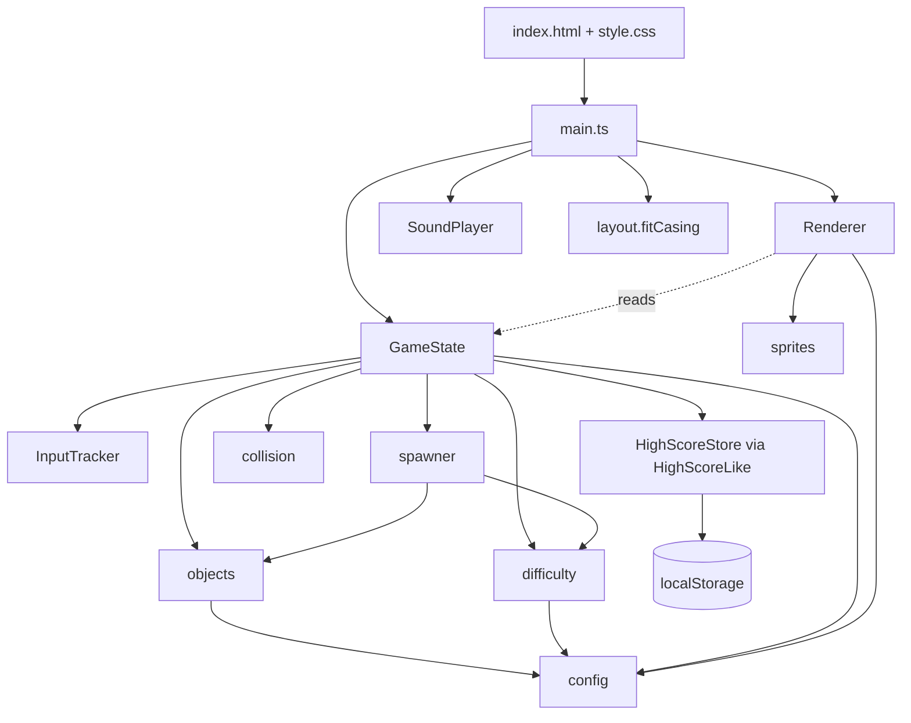

# Architecture

## Architecture Analysis

### System Overview
A client-only single-page browser app. `index.html` hosts a console casing and a 240x160 canvas. `src/main.ts` wires DOM events, a fixed-timestep loop, and three collaborators: `GameState` (rules, no DOM), `Renderer` (Canvas 2D), and `SoundPlayer` (Web Audio). There is no backend, no network, and no runtime dependency.

### Architectural Style
Monolithic client app with a clear logic/presentation split:
- Pure logic layer `src/game/` has no DOM or browser references (it takes `StorageLike` and a `Random` by injection), so it is tested under Vitest's node environment.
- Presentation layer `src/render/` and `src/audio/` consume game state and events.
- Composition root `src/main.ts` owns all browser wiring.
Communication from logic to presentation is a polled event queue (`GameState.drainEvents()`), not callbacks.

### Component Relationships



Text fallback: `index.html` loads `main.ts`. `main.ts` creates `GameState`, `Renderer`, `SoundPlayer`, and calls `fitCasing`. `GameState` uses `InputTracker`, `spawner`, `collision`, `objects`, `difficulty`, `config`, and an injected high-score store backed by `localStorage`. `spawner` uses `difficulty` and `objects`. `Renderer` reads `GameState` and uses `sprites` and `config`.

### Data Flow
1. Keyboard, pointer, and button events call `GameState.inputDown/inputUp/pressPower/pressStart`.
2. The rAF loop accumulates time and calls `state.update(1/60)` and `renderer.update(1/60)` per fixed step (max frame 0.25 s).
3. `GameState` appends `GameEvent`s (`power-on`, `game-start`, `catch`, `virus-hit`, `life-lost`, `game-over`).
4. `flushEvents` drains them: `Renderer.onEvent` starts effects, `soundFor` maps to a `SoundName` for `SoundPlayer.play`.
5. `Renderer.draw(state, now)` paints the full screen every frame.
6. On game over, `HighScoreStore.submit` persists a new best.

### Key Design Decisions
- Fixed timestep with an accumulator, so resizing or rotating never pauses the game.
- Injectable `Random` and `HighScoreLike` for deterministic tests.
- Sprites are string bitmaps; sounds are note lists; no binary assets (copyright-safe).
- One object is resolved per update when several touch HUMAN: VIRUS first, otherwise earliest spawned.
- Whole casing is scaled by CSS transform computed in `layout.ts`.
- Phase is a string union on `GameState`; transitions are inline in methods.

### Improvement Opportunities
- Add a stage layer (stage index, objective counter, restoration percentage) in the logic layer, plus new phases (stage-clear, victory) without touching the DOM.
- Split `renderer.ts` (screens, effects, primitives) so new screens stay readable.
- Make object kind data-driven (sprite, fall time, points per kind) instead of three parallel records.
- Extend the event set and sound map for new events.

## Interaction Diagrams

### Catch a rescue object

```mermaid
sequenceDiagram
  participant Loop as main.ts frame loop
  participant GS as GameState
  participant COL as collision
  participant R as Renderer
  participant S as SoundPlayer
  Loop->>GS: update(1/60)
  GS->>GS: spawn and stepObject
  GS->>COL: resolveCollisions(human, objects)
  COL-->>GS: handled, touched
  GS->>GS: score += POINTS[kind]; push catch event
  Loop->>GS: drainEvents()
  GS-->>Loop: [catch]
  Loop->>R: onEvent(catch) popup, spark, flash
  Loop->>S: play(catch-llm|gpu|robot)
  Loop->>R: draw(state, now)
```

Text fallback: the loop calls `update`; `GameState` spawns, moves, resolves collisions, adds points, and queues a `catch` event. The loop drains events, sends them to `Renderer.onEvent` and `SoundPlayer.play`, then calls `Renderer.draw`.

### VIRUS hit to game over

```mermaid
sequenceDiagram
  participant GS as GameState
  participant HS as HighScoreStore
  participant Loop as main.ts
  participant R as Renderer
  GS->>GS: handle(virus): lives - 1
  GS-->>Loop: virus-hit, life-lost events
  Loop->>R: glitch and warning effects
  alt lives == 0
    GS->>HS: submit(score)
    HS-->>GS: newHighScore
    GS-->>Loop: game-over event
    Loop->>R: game over screen
  end
```

Text fallback: a VIRUS contact removes one life and queues `virus-hit` and `life-lost`. At zero lives the state submits the score to the high-score store and queues `game-over`; the renderer shows the GAME OVER screen, and a new press after 2 seconds restarts.
