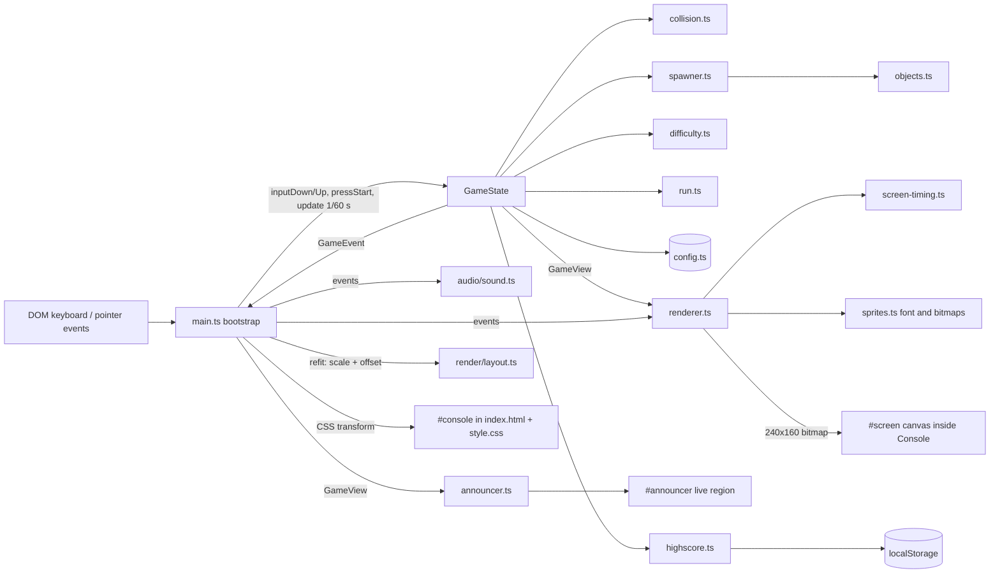
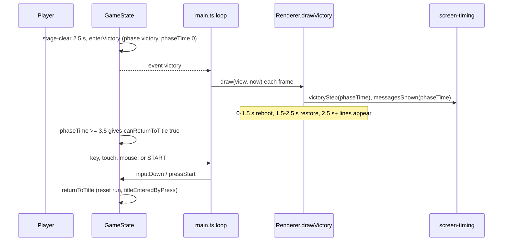
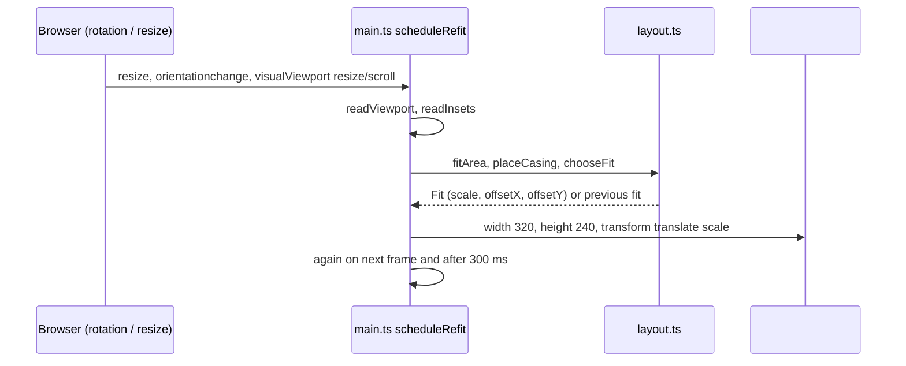
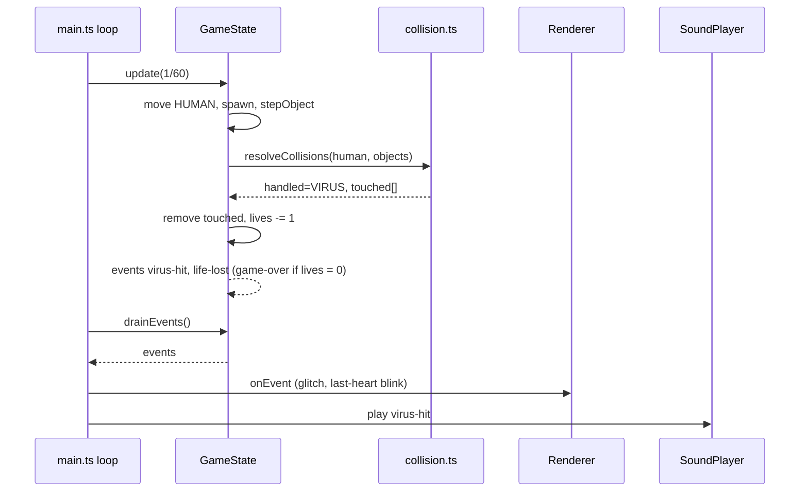
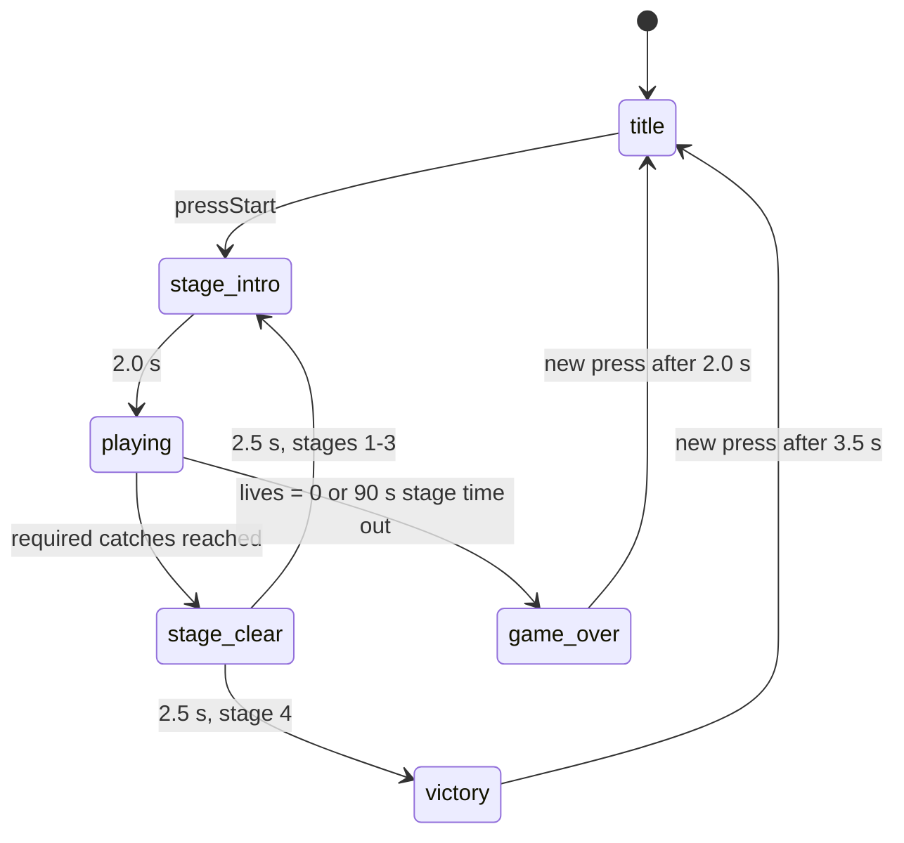

# Architecture Analysis
## System Overview
A single-page, client-only TypeScript game. `src/main.ts` wires DOM input, a fixed-step loop, a pure game-rules class (`GameState`), a Canvas renderer, and a Web Audio sound player. There is no backend.
## Architectural Style
Monolithic browser app with a strict logic/render split: `src/game/` has no DOM, canvas, or audio code (`state.ts:46-50` comment, imports in dependencies.md). The renderer reads a `GameView`; the sound player and renderer react to drained `GameEvent`s.
## Component Relationships

Text fallback: DOM events enter `main.ts`; it drives `GameState.update(1/60)`. `GameState` uses collision, spawner/objects, difficulty, run, and config, and publishes a `GameView` (read by the renderer and the announcer) and `GameEvent`s (drained by `main.ts` and sent to the renderer effects and the sound player). The renderer takes timing numbers from `screen-timing.ts` and bitmaps and the font from `sprites.ts`. High scores go through `HighScoreStore` to localStorage. Separately, `main.ts` asks `layout.ts` for a scale and offset and applies them as a CSS transform on `#console`, which holds the 240x160 canvas that the renderer draws.
## Victory Ending Flow (this run, `state.ts`, `config.ts`, `renderer.ts`, `screen-timing.ts`, `sprites.ts`, `announcer.ts`, `main.ts`)
### Reaching victory
A catch that reaches `requiredCount` on Stage 4 sets `run.complete` and AI 100 (`run.ts:25-33`), `clearStage` adds the bonus and enters `stage-clear` (`state.ts:209-224`); after `STAGE_CLEAR_DURATION` 2.5 s `finishStageClear` calls `enterVictory` (`state.ts:226-242`). `enterVictory` sets `phase = 'victory'`, resets `phaseTime`, clears objects, submits the score to the high-score store, and queues `{type: 'victory', score, newHighScore}`. `update` does nothing else in this phase (`state.ts:172-173`): the only clock is `phaseTime`.
### Constants and timing (`config.ts:42,46-48`; helpers `screen-timing.ts:33-72`)
| Constant | Value | Meaning |
|---|---|---|
| `VICTORY_DURATION` | 3.5 s | Phase length for `canReturnToTitle`; also start of the `hold` step |
| `VICTORY_REBOOT_END` | 1.5 s | End of `reboot`: broken face, bar 75 to 100, noise lines 6 to 0 |
| `VICTORY_RESTORE_END` | 2.5 s | End of `restore`: restored face, bar 100, no text yet |
| `VICTORY_MESSAGE_STEP` | 0.33 s | One new message line every 0.33 s from 2.5 s (`messagesShown`, max 3) |
`victoryStep(t)`: reboot below 1.5, restore below 2.5, messages below 3.5, hold from 3.5. Bad time (NaN, negative) counts as 0. `blinkOn(t)` is true in the first half of each second (`BLINK_HZ = 1`).
### Screen layout today (`renderer.ts:296-319`, logical 240 x 160)
| Element | Position / scale | Shown when |
|---|---|---|
| AI face 24x24 (`AI_FACE_BROKEN` then `AI_FACE_RESTORED`) | x 108, y 8 | always |
| AI bar and `100%` | y 58, bar x 40-200 | always |
| Noise lines | random, 6 falling to 0 | reboot only (function returns after) |
| `AI RESTORED — 100%` | centred, y 40, scale 2 | `messagesShown >= 1` |
| `HUMANS SAVED AI.` | centred, y 76, scale 1 | `messagesShown >= 2` |
| `SAVE THE AI. SAVE THE FUTURE.` | centred, y 90, scale 1 | `messagesShown >= 3` |
| `SCORE` + 7-segment value | label x 56, y 108 | hold step |
| `HI-SCORE` + value, blinking `NEW!` at x 136 | y 122 | hold step; `NEW!` if `newHighScore` and blink on |
| blinking `PRESS ANY KEY` | centred, y 144 | hold step and `canReturnToTitle` and blink on |
Line 1 is 18 chars at scale 2: width `4*18*2 - 2 = 142` px. The longest scale-1 line is 29 chars = 115 px.
### Returning to title
`canReturnToTitle` is true in `victory` from `phaseTime >= 3.5 - EPS` (`state.ts:114-118`). `pressStart()` (Enter/Space or the START button) returns to title if allowed (`:129-139`); `inputDown` of any NEW id (key, touch, mouse) returns too (`:142-145`). `returnToTitle` resets run, score, lives, objects and sets `titleEnteredByPress` so the same press cannot start a new run (`:255-265`, `:131-134`). Keys held across the boundary are not new (`input.ts:17-21`). Before 3.5 s presses do nothing in `victory`.
### Font and text measurement (`sprites.ts:249-298`, `renderer.ts:428-456`)
- Glyph 3 x 5 (`FONT_W`, `FONT_H`); advance 4 px x scale; width = `4 * n * scale - scale`; centred text starts at `Math.round(x - width / 2)`.
- Characters: A-Z, 0-9, `+ ! - — % . : /` and space. Not present: `, ? ' " ( ) ; = < >`. `drawText` upper-cases input (`:444`), so lowercase draws as capitals. A character without a glyph draws a blank cell but still advances (`:445,454`). No wrapping, clipping, or measuring helper exists besides `textWidth` (private).
- Capacity at scale 1: 60 chars per 240 px line (56 with 8 px side margins); scale 2: 30 (28). Height: glyph 5 px; the title screen uses an 8 px line pitch (`renderer.ts:194-196`), giving 20 lines in 160 px with no other content, 22 at 7 px.
### Announcer and sound
`announcer.ts:35` returns the victory text `AI restored, 100%. Humans saved AI. Save the AI, save the future. Score N.` (+ ` New high score.`) for the `default` branch of the phase switch; the key is `victory:4` and `main.ts:182-192` writes it to the live region only when the key changes. The cue `victory` (ten rising notes, about 2.5 s, `sound.ts:75-86`) plays once when the `victory` event is drained (`main.ts:170-176`); it is not tied to text steps.
### Victory sequence

Text fallback: after the Stage 4 clear screen the state enters `victory` and queues the `victory` event. Each frame the renderer draws the screen from `phaseTime` only, using the step and message-count helpers. After 3.5 s a new press returns to the title and resets the run.
## Responsive Layout and Orientation (`src/main.ts:48-106`, `src/render/layout.ts`; re-read at `49efe17`)
### Coordinate spaces
| Space | Size | Defined at |
|---|---|---|
| Game (logical) | 240 x 160 | `config.ts:5-6` |
| Canvas bitmap | 240 x 160, never resized by script; no DPR handling | `index.html` (skimmed), `renderer.ts:116-119` |
| Casing (`#console`) | 320 x 240 CSS px, scaled whole by a CSS transform | `layout.ts:2-3`, `main.ts:87-89` |
| Viewport | `visualViewport` rect (x, y, width, height), else `innerWidth/innerHeight` | `main.ts:54-60` |
| Safe area | `#stage` padding read with `getComputedStyle` as insets | `main.ts:62-70`, `layout.ts:59-70` |
`refit` computes `fitArea(viewport, insets)`, `placeCasing(area)` (scale = min(w/320, h/240), centred, offsets include `area.x/y`), keeps the previous fit when the new scale is not valid (`chooseFit`), and writes `translate(offsetX, offsetY) scale(s)` (`main.ts:72-90`). Held input is released when portrait/landscape flips (`:76-80`). Re-fits run on `resize`, `orientationchange`, `visualViewport` `resize` and `scroll`, now, next frame and after `SETTLE_DELAY_MS` 300 (`:92-106`). Touch direction uses `touchSide(clientX, lastArea ?? viewport)`, the area centre (`main.ts:153`, `layout.ts:89-91`). This differs from the prior store, which described half of `innerWidth` and a single synchronous re-fit; those orientation findings were addressed by `49efe17` (see code-quality-assessment.md).

Text fallback: every size-related event refits at once, next frame and after 300 ms; the casing is placed inside the safe visible area and the last valid fit is kept if the new size is invalid. The canvas bitmap is unchanged, so all drawn text positions are independent of orientation: portrait and landscape differ only in the CSS scale.
## Data Flow
1. `main.ts` frame loop accumulates real time (capped at 0.25 s per frame, `main.ts:22,198`) and calls `state.update(1/60)` per step (`:201-206`). The loop is not paused by resize or rotation.
2. `update` adds dt to `phaseTime` (`state.ts:158`) and dispatches by phase (`:159-174`). `updatePlaying` (`:270-308`): add `stageTime`; move HUMAN; spawn; move objects; resolve collisions and handle one object; remove objects below the area; time-out check last.
3. Events are drained, drawn as effects, and mapped to sounds (`main.ts:170-176`); then the renderer draws and the announcer updates (`:207-209`).
## Game Rules: Current Values (verified against `config.ts` and `state.ts` at `49efe17`)
### Play area and HUMAN
| Item | Value | Source |
|---|---|---|
| Play area | 240 x 160 logical px | `config.ts:5-6` |
| HUMAN size | 20 x 20, speed 130 px/s, y = 140, starts centred | `config.ts:11-14`, `state.ts:59` |
| Objects | 16 x 16 for every kind | `config.ts:9-10` |
Collision, object motion and spawner internals (re-read this run, `collision.ts`, `objects.ts`, `spawner.ts`): strict AABB overlap, one handled object per update (VIRUS first), objects vanish at y >= 160, spawn x uniform over [0, 224], VIRUS aimed at HUMAN with probability 1/3 (`config.ts:121-123`).
### Phase timing and run end
Intro 2.0 s, clear 2.5 s, victory 3.5 s, game-over 2.0 s (`config.ts:40-43`). Phase machine: title -> stage-intro -> playing -> stage-clear -> (next stage-intro | victory); `playing` ends in game-over by lives 0 (`state.ts:335-338`) or time out (`:307`). `phaseTime` resets at each phase change; `stageTime` and `spawnTimer` are private (`state.ts:67,70`). The first spawn comes 0.5 s into play (`config.ts:119`, `state.ts:202`).
- Events (`types.ts:73-82`): `run-start`, `stage-start`, `catch`, `virus-hit`, `life-lost`, `stage-clear`, `time-warning`, `victory`, `game-over`.
### Fall times (`config.ts:17-25`)
mainframe, tape, floppy, llm 4.0 s; robot 3.5 s (sway 22 px, period 1.6 s); virus 2.2 s (jitter 16 px); gpu 2.5 s; collectibles get a per-stage `collectibleSpeedFactor` 1.2-1.5 (`config.ts:77,87,97,107`). Stage start/cap difficulty values: `config.ts:68-109`; steps of 8 s capped at 4 (`config.ts:58-59`).
## HUD Layout (`renderer.ts:223-268`, columns `:72-78`)
```
x: 2 name | 34 "AI n%" | 66 score (7-seg, y 3) | 108 caught/required | 132 "T n" timer | 202 hearts (3 x 7 px, gap 3)
y: 4 (text); rule at y=14; floor line at y=159
```
HUD positions are logical canvas coordinates and do not depend on viewport size or orientation. Text width at scale 1 is `4 x chars - 1` px. The timer is hidden on blink-off frames in the last 10 s (`timerVisible`).
## Key Design Decisions
- All tunables in `config.ts` with requirement IDs in comments; difficulty is data-driven per stage (start and cap).
- Deterministic fixed-step update with injectable `Random` for tests (`state.ts:41-44`).
- Pure display helpers in `render/screen-timing.ts` so they run without a canvas; screens draw from `phaseTime` and `GameView` only, so there is no per-screen renderer state.
- One fixed logical casing (320 x 240) scaled as a whole by a CSS transform; the canvas bitmap stays 240 x 160.
- Touch has no on-screen buttons: left or right half of the casing area.
- `touchmove` is blocked on the document (`main.ts:166`), so any scrolling text must be drawn on the canvas, not scrolled by the page.
## Improvement Opportunities
- `renderer.ts` (493 lines) mixes screen layouts with effects; each screen hard-codes y positions.
- No text wrapping or measuring helper is exposed; long text must be pre-split into lines by the caller.
## Interaction Diagrams
### Victory sequence
See "Victory Ending Flow" above (sequence diagram with text fallback).
### Rotation refit
See "Responsive Layout and Orientation" above.
### VIRUS hit during play

Text fallback: each step the loop calls `update`; `GameState` moves HUMAN, spawns, moves objects, asks `resolveCollisions` for the handled object; for a VIRUS it removes all touched objects, decrements lives, queues `virus-hit` and `life-lost` (and `game-over` at 0). The loop then drains events and sends them to the renderer and sound player.
### Phase flow and run end

Text fallback: the run goes title, stage-intro (2.0 s), playing. From playing it leaves by clearing the stage (stage-clear, 2.5 s, then the next intro or victory after Stage 4), by losing the last life, or by the stage timer reaching zero (both game-over). Game-over and victory return to the title on a new press after 2.0 s and 3.5 s.
