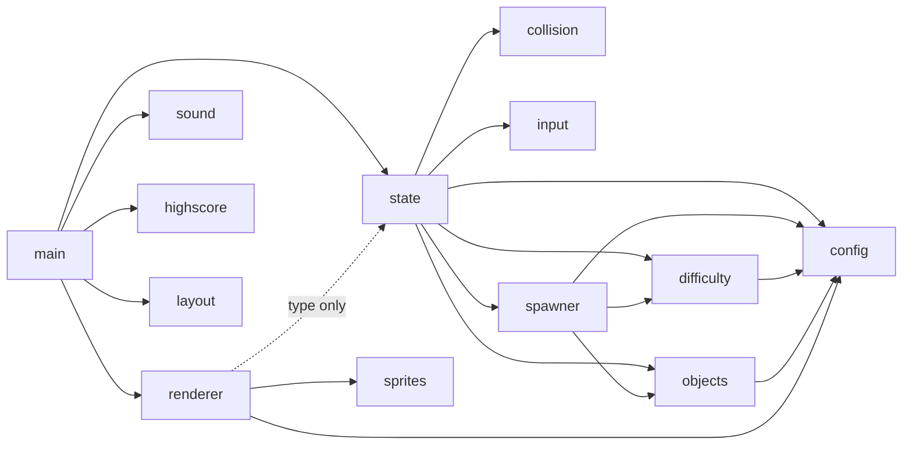

# Dependencies

## External (npm)
Runtime dependencies: none.

Dev dependencies (exact pins, `package.json`):
| Package | Version | Purpose |
|---|---|---|
| typescript | 7.0.2 | type check (`tsc --noEmit`) |
| vite | 8.3.7 | dev server and production build |
| vitest | 5.1.0 | unit tests |

`package-lock.json` exists but was not opened. Transitive dependencies were not enumerated. No audit was run.

## External (browser platform)
Canvas 2D, Web Audio (`AudioContext`, `webkitAudioContext` fallback), `localStorage`, Pointer Events, Keyboard Events, `visualViewport`, `requestAnimationFrame`.

## External (Python tooling)
Standard library only (`argparse`, `csv`, `json`, `os`, `socket`, `datetime`, `pathlib`, `subprocess`, `re`). Reads Kiro session logs from `~/.kiro/sessions` (override `KIRO_SESSIONS_DIR`).

## Internal module dependencies

Text fallback: `main` imports `state`, `renderer`, `sound`, `highscore`, `layout`. `state` imports `collision`, `config`, `difficulty`, `input`, `objects`, `spawner`. `spawner` imports `difficulty`, `objects`, `config`. `difficulty` and `objects` import `config`. `renderer` imports `config`, `sprites`, and the `GameState` type only. `collision`, `input`, `highscore`, `sprites`, `layout`, and `sound` import nothing internal.

No circular imports were seen. Tests import from `src/` only.
