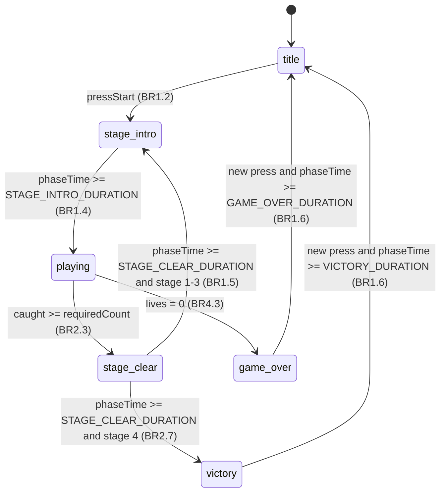
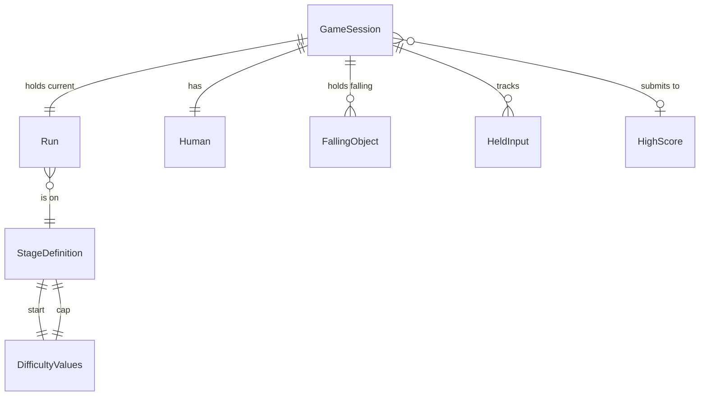

# Functional Specification: u1-game-rules

Behavioural specification of the four-stage game rules. It is the source of truth for the phase state machine and the update workflows. Data shapes are in `entities.md` and decision logic in `rules.md`; both views below are derived from them.

Inputs: `aidlc/spaces/default/intents/261113-ai-catch-mvp/inception/units-generation/unit-of-work.md` (U1 scope), `aidlc/spaces/default/intents/261113-ai-catch-mvp/inception/units-generation/unit-of-work-story-map.md`, `aidlc/spaces/default/intents/261113-ai-catch-mvp/inception/user-stories/stories.md`, `aidlc/spaces/default/intents/261113-ai-catch-mvp/inception/requirements-analysis/requirements.md`, `aidlc/spaces/default/intents/261113-ai-catch-mvp/inception/domain-design/components.md`, `aidlc/spaces/default/intents/261113-ai-catch-mvp/inception/contract-design/contract-summary.md`, and `functional-design-questions.md` (Q1-Q5, all A).

## Stories Implemented

From `stories.md`, per the story map: US1.1 (title, START), US2.1 (play a stage), US3.1 (stage clear), US4.1 (Stage 4 and victory), US5.1 (game over and restart), US7.1 (rules testable without a browser, AC7.1.7). The drawing, sound, accessibility, and publishing parts of those stories belong to U2-U5.

## Module Placement

| File | Holds | Change |
|---|---|---|
| `src/game/types.ts` (new, type-only) | `ObjectKind`, `CollectibleKind`, `Phase`, `GameView`, `GameEvent`, `DifficultyValues`, `StageDefinition`, `GameControls` (C1-C4) | New [Q1] |
| `src/game/config.ts` | General constants and the stage catalogue `STAGES` | Extended; `STARTUP_DURATION` and the old global difficulty constants removed |
| `src/game/run.ts` (new) | RunProgress: start, record catch, clear check, advance | New |
| `src/game/difficulty.ts` | `difficultyAt(stage, stageTime): DifficultyValues` | Rewritten to stage parameters (ADR-002) |
| `src/game/spawner.ts` | `pickKind(collectibles, virusShare, random)`, `spawnObject(...)` | Takes stage collectibles and current values |
| `src/game/objects.ts` | Seven kinds, motion | Three new kinds (straight fall); imports `ObjectKind` from `types.ts` |
| `src/game/state.ts` | GameState phase machine, implements `GameView` and `GameControls`, `view` getter | Phases rewritten |
| `src/game/input.ts` | InputTracker; `clear()` used by `releaseAll` | Unchanged logic |
| `src/game/collision.ts`, `highscore.ts` | Unchanged | — |
| `src/main.ts` | U1 section only: POWER path removed, `releaseAll` on blur, `pressStart` wiring | Minimal edits; Renderer gets placeholder drawing for new phases so the build stays green (C5) |

`ObjectKind` is `'mainframe' | 'tape' | 'floppy' | 'llm' | 'gpu' | 'robot' | 'virus'`; `CollectibleKind` excludes `'virus'`.

## Phase State Machine

Text version: title → stage-intro on START; stage-intro → playing after 2.0 s; playing → stage-clear when the target is reached, or → game-over at 0 lives; stage-clear → next stage-intro after 2.5 s for Stages 1-3, or → victory after Stage 4; victory (after 3.5 s) and game-over (after 2.0 s) → title on a new press. (State names use `_` for `-` in the diagram only.)

Durations are the C1 constants `STAGE_INTRO_DURATION = 2.0`, `STAGE_CLEAR_DURATION = 2.5`, `VICTORY_DURATION = 3.5`, `GAME_OVER_DURATION = 2.0` (starting values). A duration is reached when `phaseTime >= duration - EPS` with `EPS = 1e-9` (BR1.10). A transition sets `phaseTime = 0`. One `update` performs at most one timed transition; leftover time is dropped.

### One press, one transition

Bootstrap reports Enter and Space as `inputDown(id, null)` followed by `pressStart()` in the same key event (existing `main.ts`), and the START button as `pressStart()` only (C4). On game over or victory the `inputDown` returns to the title; the `pressStart` of that same key event must not start a run. GameState sets `titleEnteredByPress` when it enters the title through W7; a `pressStart` on the title with the flag set is ignored and clears it; any valid `update` clears it (BR1.9). So one press moves at most one step: game-over → title, then a later press title → stage-intro.

### Input by phase

| Phase | `pressStart` | `inputDown` (new press) | Held direction |
|---|---|---|---|
| title | starts a run (BR1.2) | tracked only (BR1.3) | ignored |
| stage-intro | ignored | tracked only (BR7.3) | carried into play |
| playing | ignored | tracked; moves HUMAN (BR7.1, BR7.2) | moves HUMAN |
| stage-clear | ignored | tracked only (BR7.3) | carried into the next play |
| victory, game-over | returns to title if `canReturnToTitle` (BR1.6) | returns to title if `canReturnToTitle` (BR1.6) | ignored |

`inputUp` and `releaseAll` (BR7.4) work in every phase.

## Workflows

### W1 — Start a run (title → stage-intro)

1. `pressStart` while phase is title.
2. RunProgress starts a run: stageIndex 0, caught 0, aiRestoration 0, complete false.
3. score 0, lives `START_LIVES`, newHighScore false, objects empty.
4. Emit `run-start`.
5. Enter stage-intro (W2).

### W2 — Enter a stage intro

1. phase = stage-intro, phaseTime 0, stageTime 0, spawnTimer 0, objects empty.
2. HUMAN to bottom centre.
3. Emit `stage-start { stageIndex }`.
4. Each update adds dt to phaseTime; at `STAGE_INTRO_DURATION` phase becomes playing with phaseTime 0.

### W3 — One playing update (dt)

Order inside one update:

1. phaseTime + dt, stageTime + dt.
2. Move HUMAN by the current direction (BR7.1).
3. Read current difficulty `difficultyAt(stage, stageTime)` (BR5.1).
4. spawnTimer + dt; spawn loop with the max-objects skip (BR6.1-BR6.3).
5. Step every object (existing motion).
6. Resolve collisions: remove every touched object; handle at most one (BR4.2).
   - Collectible: score + points, emit `catch`; record progress (BR2.2); if the target is reached, run W4 and stop this update.
   - VIRUS: lives − 1, emit `virus-hit` then `life-lost` (BR4.1); if lives = 0, run W6 and stop this update.
7. Remove objects below the play area with no penalty (BR2.6).

### W4 — Stage clear

1. Remove every falling object.
2. score + stage.clearBonus; aiRestoration + 25; if stageIndex = 3, complete = true.
3. Emit `stage-clear { stageIndex, bonus, aiRestoration }` (after the `catch` event of the same update).
4. phase = stage-clear, phaseTime 0. stageIndex and caught stay as they are (C1 table).
5. At `STAGE_CLEAR_DURATION`: if complete, run W5; otherwise stageIndex + 1, caught 0, run W2.

### W5 — Victory

1. phase = victory, phaseTime 0, objects empty.
2. newHighScore = store.submit(score) (BR8.1).
3. Emit `victory { score, newHighScore }`.
4. After `VICTORY_DURATION`, `canReturnToTitle` is true; a new press runs W7.

### W6 — Game over

1. phase = game-over, phaseTime 0, objects empty; the run keeps stageIndex, caught, aiRestoration.
2. newHighScore = store.submit(score) (BR8.1).
3. Emit `game-over { score, newHighScore }`.
4. After `GAME_OVER_DURATION`, `canReturnToTitle` is true; a new press runs W7.

### W7 — Return to title

1. Triggered by `pressStart`, or an `inputDown` that is a new press, while `canReturnToTitle`.
2. phase = title, phaseTime 0; run reset to Stage 1, caught 0, AI 0%; score 0, lives `START_LIVES`, newHighScore false.
3. Set `titleEnteredByPress` (BR1.9), so the `pressStart` of the same key event is ignored.
4. No event (the title is drawn from the view). A later, separate `pressStart` starts a run (W1).

## Event Order

Events (C2) are queued in the order they happen and drained once per frame.

| Situation | Events in order |
|---|---|
| START on title | `run-start`, `stage-start {0}` |
| Catch that does not clear | `catch` |
| Catch that clears | `catch`, `stage-clear` |
| VIRUS, lives left | `virus-hit`, `life-lost` |
| VIRUS, last life | `virus-hit`, `life-lost {0}`, `game-over` |
| Stage-clear ends, Stages 1-3 | `stage-start {n+1}` |
| Stage-clear ends, Stage 4 | `victory` |

## Stage Catalogue (starting values)

| Stage | Name | Collectibles | Required | Fall speed start → cap | Spawn interval (s) start → cap | VIRUS share start → cap | Max objects start → cap | Bonus |
|---|---|---|---|---|---|---|---|---|
| 1 | FORTRAN | mainframe | 10 | 1.0 → 1.2 | 1.2 → 1.0 | 0.10 → 0.15 | 3 → 4 | 500 |
| 2 | COBOL | tape | 12 | 1.1 → 1.35 | 1.1 → 0.9 | 0.15 → 0.22 | 4 → 5 | 500 |
| 3 | BASIC | floppy | 14 | 1.2 → 1.5 | 1.0 → 0.8 | 0.20 → 0.28 | 4 → 5 | 500 |
| 4 | LLM | llm, gpu, robot | 16 | 1.3 → 1.7 | 0.9 → 0.7 | 0.25 → 0.35 | 5 → 6 | 500 |

Stage 3 equals Stage 2 on max objects and is strictly harder on the other three values, which satisfies BR5.3. In-stage steps: `DIFFICULTY_STEP_SECONDS = 8`, `DIFFICULTY_STEPS_TO_CAP = 4` [Q2]. Other constants: `AI_RESTORATION_STEP = 25`, `START_LIVES = 3`, `POINTS` and `FALL_TIME` per BR3.1 and BR6.3.

Example (Stage 1, BR5.1): at stageTime 17 s, n = 2, f = 0.5, so fall speed 1.1, interval 1.1 s, VIRUS share 0.125, max objects floor(3.5) = 3.

## Edge Cases

| Case | Behaviour | Rule |
|---|---|---|
| Large dt (tab returns) | `main.ts` clamps the frame (`MAX_FRAME`) and steps at `STEP`; the spawn loop is capped at 100 per update | BR1.7, BR6.1 |
| Screen full | spawn skipped, no burst later | BR6.1 |
| VIRUS and collectible touched together | only the VIRUS is handled; both removed | BR4.2 |
| Catch reaching the target while a VIRUS is falling | stage clears; the VIRUS is removed with the rest | BR2.3 |
| START held from title into play | the held key is tracked; it is not a direction, so nothing moves | BR7.3 |
| Key held from play into game over | not a new press; no return to title until released and pressed again | BR1.6 |
| Enter on game over (inputDown then pressStart) | returns to the title only; the run does not start until a later press | BR1.9 |
| Timer exactly at a duration or step boundary | reached (EPS tolerance) | BR1.10 |
| Window blur | every held input released | BR7.4 |
| No high-score store injected | best 0, newHighScore false | BR8.1 |
| Storage throws | session-only best, no error | BR8.2 |

## Test Plan (tests first)

Vitest under node with an injected random source and a fake store (BR9.1). Existing tests for power-off, startup, `canRestart`, and time-only difficulty are rewritten; the rest stay green.

- `config` / catalogue: four stages, names, collectibles without virus, counts, bonus; monotonic difficulty (BR2.1, BR5.3).
- `run`: progress, combined Stage 4 count, +25% steps, complete after Stage 4 (BR2.2-BR2.4).
- `difficulty`: start at 0 s, steps at 8 s, cap after 32 s, invalid time (BR5.1).
- `spawner`: VIRUS by share from 0 s, equal collectible shares, stage collectibles only (BR6.2, BR6.3).
- `state`: every transition in the state machine, input by phase, event order, Enter on game over and victory (inputDown then pressStart) reaching only the title, transitions exactly at duration boundaries, carry-over of score and lives, objects cleared, high score at game over and victory, held-key rule, `releaseAll`, invalid dt (BR1.x, BR2.x, BR3.x, BR4.x, BR7.x, BR8.1).

## Entity Relationships (derived from `entities.md`)

Text version: a GameSession has one Human and one current Run, holds zero or more FallingObjects and HeldInputs, and may submit to one HighScore. A Run is on one StageDefinition, which has a start and a cap DifficultyValues.

## Rules Summary (derived from `rules.md`)

| Group | Rules | Topic |
|---|---|---|
| BR1 | BR1.1-BR1.10 | Phases, timers, title return, no pause, view values, one press one transition, EPS |
| BR2 | BR2.1-BR2.7 | Catalogue, progress, stage clear, AI %, carry-over, victory |
| BR3 | BR3.1-BR3.2 | Points; VIRUS never scores |
| BR4 | BR4.1-BR4.3 | VIRUS lives, one object per update, game over |
| BR5 | BR5.1-BR5.4 | In-stage steps, reset per stage, monotonic stages, gentle Stage 1 |
| BR6 | BR6.1-BR6.3 | Spawn interval and max, kind choice, position and speed |
| BR7 | BR7.1-BR7.4 | Movement, direction priority, automatic screens, focus loss |
| BR8 | BR8.1-BR8.2 | High score update and safe storage |
| BR9 | BR9.1-BR9.2 | No DOM, injection, tests first, no throws |
