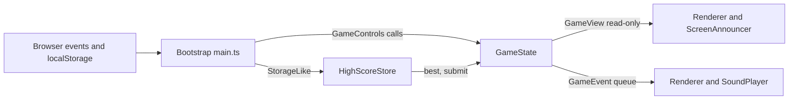

# Security Design: u1-game-rules

How the game-rules unit meets its security and safety requirements in `aidlc/spaces/default/intents/261113-ai-catch-mvp/construction/u1-game-rules/nfr-requirements/security-requirements.md`, using the stack in `aidlc/spaces/default/intents/261113-ai-catch-mvp/construction/u1-game-rules/nfr-requirements/tech-stack-decisions.md`. Behaviour comes from `aidlc/spaces/default/intents/261113-ai-catch-mvp/construction/u1-game-rules/functional-design/functional-spec.md`; boundary rules from `aidlc/spaces/default/intents/261113-ai-catch-mvp/inception/contract-design/contract-summary.md` (C1-C4).

No stage questions were needed: the unit has no accounts, server, network, or personal data, so the design reduces to input hygiene, isolation, and bounded work.

## Approach

Defence in depth for a pure, in-process library:

1. **Isolation by construction**: game rules see the browser only through two injected interfaces.
2. **Untrusted input is normalised at the edge**: stored text and input calls are checked where they enter.
3. **Total functions**: every public method and view read returns normally for any input.
4. **Bounded work**: every loop has a fixed upper bound.

Authentication, authorization, encryption, security headers, CSRF/XSS protection, and secrets management do not apply to this unit: it renders nothing to the DOM, sends nothing, and stores one integer.

## Design Decisions

| ID | Requirement | Design | Verified by |
|---|---|---|---|
| SD-1 | NFR5.1 | `src/game/` modules import only `./*` siblings. No `fetch`, `XMLHttpRequest`, `WebSocket`, or `import()` of remote code. | Code review of the `import` lines in the PR; `grep` for `fetch\|XMLHttpRequest\|WebSocket` in `src/game` returns nothing |
| SD-2 | NFR8.1 | Browser access only through `StorageLike { getItem; setItem }` (HighScoreStore constructor) and `Random = () => number` (GameState options). No `window`, `document`, `localStorage`, `performance`, or `AudioContext` reference in `src/game/`. Bootstrap (`main.ts`) is the only place that passes `window.localStorage` and `Math.random`. | Vitest runs under `environment: node`, so a stray DOM global throws in tests; code review. The type check alone does not catch it, because `tsconfig.json` includes the DOM library for `main.ts` and the Renderer |
| SD-3 | NFR8.2 | `parseStoredScore` accepts only `^\d+$` after trimming and `Number.isSafeInteger`; everything else is 0. The value is only ever compared and displayed as a number, never evaluated. Existing implementation kept. | Existing and added unit tests for invalid strings |
| SD-4 | NFR8.3 | `HighScoreStore.load` and `submit` wrap storage calls in `try/catch`; on failure the in-memory best is kept. No error leaves the store. Existing implementation kept. | Unit test with a storage stub whose methods throw |
| SD-5 | NFR8.4 | Guard clauses at the top of each `GameControls` method: invalid `dt` returns at once; `inputUp` of an unknown id is a no-op; a duplicate `inputDown` returns "not new"; methods called in a phase where they do nothing simply return (input-by-phase table in the functional spec). | Unit tests per guard |
| SD-6 | NFR8.5 | Values are clamped where they change: lives with `max(0, …)`, AI restoration with `min(100, …)`, HUMAN and object `x` with the play-area clamp, `caught` only incremented while below `requiredCount` (the stage clears at the target). Score only grows by fixed integers. | Unit test running a long simulated session with an injected random and asserting ranges after every update |
| SD-7 | NFR8.6 | The spawn loop runs at most 100 times per update; with the max-objects skip, the object list never grows past the stage's `maxObjects` through spawning. Objects already on screen are not removed early when the current max is lower (max never drops inside a stage, and the list is emptied between stages). | Unit test with a large `dt` |
| SD-8 | NFR6.1 | No asset files or third-party packages are added by this unit. | `package.json` diff in the PR is empty for U1 |

## Data Flow at the Boundaries

Text version: browser input and storage reach the rules only through Bootstrap, as `GameControls` calls and a `StorageLike` object. The rules hand data out only as the read-only `GameView` and the drained `GameEvent` list.

## Residual Risk

| Risk | Impact | Accepted because |
|---|---|---|
| A player edits `localStorage` to a large valid number | Their own high score is wrong | Local, single-device data with no shared ranking (product scope) |
| A player calls methods from the browser console | Their own game changes | No shared state or server |
