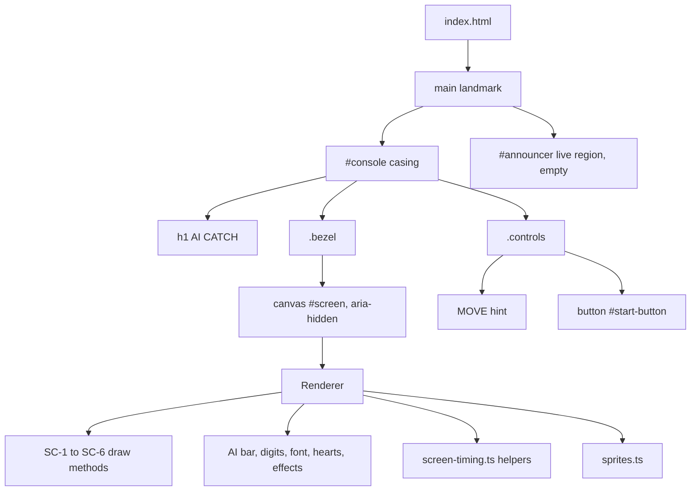

# Frontend Components: u2-screens-and-art

Component hierarchy, inputs, and state for the U2 drawing layer. Behaviour per screen is in `functional-spec.md`; contracts in `aidlc/spaces/default/intents/261113-ai-catch-mvp/inception/contract-design/contract-summary.md`; components in `aidlc/spaces/default/intents/261113-ai-catch-mvp/inception/domain-design/components.md`. There is no UI framework: the page is static HTML and the LCD is one canvas.

## Hierarchy

Text version: the page has a `main` landmark holding the console (with the `h1` label, the bezel and canvas, and the controls row with the hint and START) and the empty announcer. The Renderer draws on the canvas using screen methods, shared parts, timing helpers, and sprites.

## Components

| Component | Inputs | Internal state | Output |
|---|---|---|---|
| ConsoleShell (HTML/CSS) | none | none | DOM elements found by Bootstrap: `#console`, `#screen`, `#start-button`, `#announcer` |
| Renderer | `draw(view: GameView, now: number)`, `onEvent(e: GameEvent)`, `update(dt)` | Effect timers and lists: popups, sparks, glitch, warning, flash | Pixels on the canvas |
| Screen methods | `GameView`, `now` | none | One screen each (SC-1 to SC-6) |
| screen-timing helpers | `phaseTime`, `GameView` values | none (pure) | Step names, counts, fill percents, strings |
| Sprites | none | none | Bitmaps and glyphs |
| Layout | viewport size | none (pure) | Fit (scale, offset) |

## Interaction Flows

| Flow | Path |
|---|---|
| Frame | Bootstrap loop → `renderer.update(STEP)` → `renderer.draw(state.view, now)` |
| Event effect | Bootstrap drains events → `renderer.onEvent(e)` starts the matching effect |
| Resize | Bootstrap → `fitCasing` → console transform |
| START | Button click → Bootstrap (U1 wiring) → `pressStart`; U2 only styles the button |

## Forms and Validation

None. The only interactive control is the START button; there is no text input.

## Accessibility Hooks

- `h1` label and `main` landmark (FR13.1).
- Canvas `aria-hidden="true"`; screen meaning goes through `#announcer` (written by U4).
- START has a visible focus ring and stays a native `button`.
- `data-testid` stays on the console, canvas, and START button; `#announcer` gets `data-testid="announcer"`.
