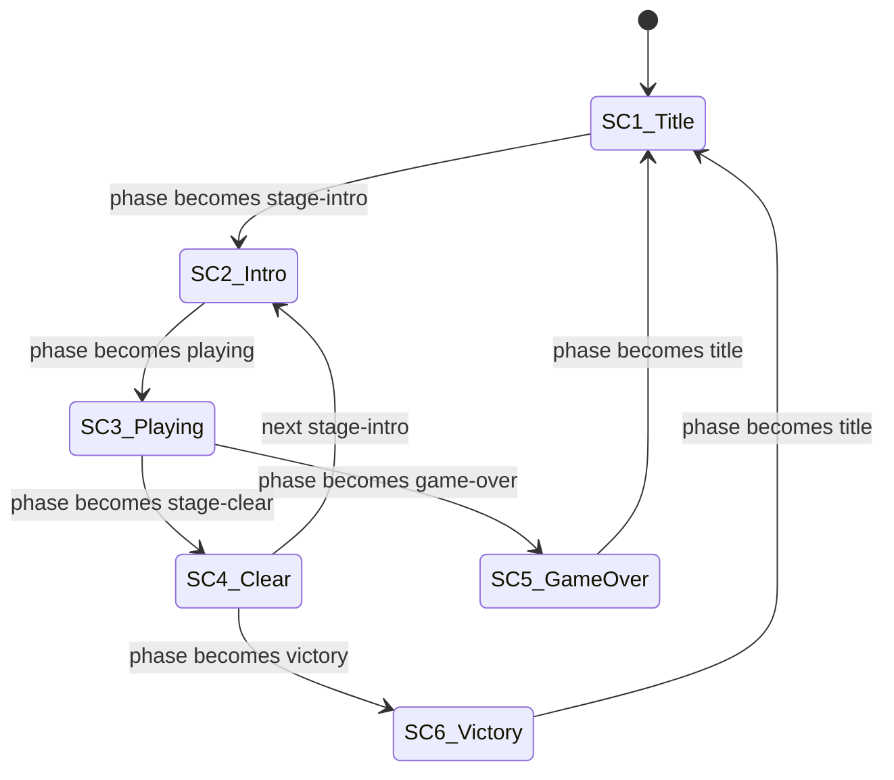

# Functional Specification: u2-screens-and-art

Behavioural specification for everything the player sees: the console page, the six LCD screens, the HUD, the effects, and the new pixel art. This is a `ui` unit, so this file is self-contained: it specifies the screen workflows and screen-to-screen transitions as they are drawn. Game rules, timers, and phase changes are owned by U1 and read through the read-only `GameView` and the `GameEvent` queue.

Inputs: the U2 scope in `aidlc/spaces/default/intents/261113-ai-catch-mvp/inception/units-generation/unit-of-work.md` and `unit-of-work-story-map.md`; stories in `aidlc/spaces/default/intents/261113-ai-catch-mvp/inception/user-stories/stories.md`; requirements in `aidlc/spaces/default/intents/261113-ai-catch-mvp/inception/requirements-analysis/requirements.md`; components Renderer, Sprites, ConsoleShell, Layout, Bootstrap in `aidlc/spaces/default/intents/261113-ai-catch-mvp/inception/domain-design/components.md`; contracts C1 (GameView, durations), C2 (events), C3 (StageDefinition), C5 (`main.ts` drawing section) in `aidlc/spaces/default/intents/261113-ai-catch-mvp/inception/contract-design/contract-summary.md`; the refined mockups (`mockups.md`, `interaction-spec.md`, `design-system-mapping.md`, `accessibility-checklist.md`); and `functional-design-questions.md` (Q1-Q4, all A; Q4 was left to the recommendation).

## Stories Implemented

From `stories.md`, per the story map: US1.1 (title screen, console without POWER), US2.1 (intro screens, extended HUD, playing screen, new object art), US3.1 (stage-clear screen and AI bar fill), US4.1 (LLM RECOVERED, victory sequence, AI face, messages), US5.1 (game-over screen with AI bar, REACHED STAGE, NEW!), and US6.1 (LCD look, shape-distinct art, extended font, effects, layout, single `h1`, keyboard play, asset records).

## Boundaries

- U2 reads `GameView` (C1) and handles `GameEvent` (C2) only. It never calls `GameControls` and never changes game state.
- Screen timing comes from `view.phaseTime` and the C1 duration constants; U2 adds only sub-step constants inside those durations (victory sub-steps, bar fill time) to `src/game/config.ts`.
- U2 edits only the drawing and layout section of `src/main.ts` (C5).
- The text written into the live region is U4's; U2 provides only the empty element (Q4).

## Module Placement

| File | Holds | Change |
|---|---|---|
| `src/render/renderer.ts` | `Renderer` class: effects, primitives, one draw method per screen | Replace U1's placeholder screens with the final ones |
| `src/render/screen-timing.ts` (new) | Pure helpers: `victoryStep`, `messagesShown`, `barFill`, `blinkOn`, HUD strings, `reachedLine` | New; unit-tested [Q1] |
| `src/render/sprites.ts` | Bitmaps and font | Add mainframe, tape, floppy, AI face (broken, restored); glyphs `%`, `.`, `:`, `—`, `/` |
| `src/game/config.ts` | Tunables | Add `VICTORY_REBOOT_END = 1.5`, `VICTORY_RESTORE_END = 2.5`, `VICTORY_MESSAGE_STEP = 0.33`, `CLEAR_BAR_FILL = 1.0`, `BLINK_HZ = 1` |
| `index.html`, `src/style.css` | ConsoleShell | `main` landmark, `h1` label, POWER removed, canvas `aria-hidden`, empty `#announcer`, silver-grey casing [Q4] |
| `src/main.ts` | Drawing and layout section | Renderer creation and draw unchanged in shape; no POWER lookup |
| `ASSETS.md` (new, repository root) | Asset originality record | Lists every bitmap and states it is original; no external asset |

## Screen Workflows

All screens draw only with `lcd.bg`, `lcd.ink`, and `lcd.ghost` (design-system-mapping). `t` below is `view.phaseTime`. Blinking prompts are on when `blinkOn(t)` is true: on for the first half of each 1 s period.

### SC-1 Title (`phase = title`)

1. Draw "AI CATCH" at scale 3, centred, y 16.
2. Draw the sprites row at y 44: mainframe, tape, floppy, LLM, VIRUS, 16 px each, evenly spaced.
3. Draw the story lines at scale 1, centred: "2045. A VIRUS BROKE THE AI." (y 72), "RECOVER COMPUTING HISTORY." (y 80), "SAVE IT." (y 88).
4. Draw "HI-SCORE" and `view.best` in seven-segment digits at y 104.
5. Draw "PRESS START" at y 132 while `blinkOn(t)`.

### SC-2 Stage intro (`phase = stage-intro`)

1. Draw "STAGE n" (scale 2, y 20) and the stage name (scale 2, y 36) from `view.stage`.
2. Draw "COLLECT", the sprite of each collectible in `view.stage.collectibles`, and "X <requiredCount>" (y 64); in Stage 4 add "TOTAL".
3. Draw "AVOID" and the VIRUS sprite (y 88).
4. Draw the AI bar at y 124 filled to `view.aiRestoration` and the percent text.
5. Nothing else moves; U1 starts play after `STAGE_INTRO_DURATION`.

### SC-3 Playing (`phase = playing`)

1. HUD row (y 0-13): stage name (x 2), "AI n%" (x 34), score in seven-segment digits (x 66), progress `caught/requiredCount` (x 108), lives as hearts with lost hearts in ghost (right-aligned). Strings come from `hudTexts(view)`.
2. 1 px rules at y 14 and y 159.
3. Falling objects from `view.objects`, each with its own sprite (`spriteFor(kind)`), centred in its box.
4. HUMAN at `view.human`, drawn inverted while the catch flash runs.
5. Effects from events: catch → "+points" pop-up rising for 0.8 s, spark for 0.28 s, flash 0.16 s; `virus-hit` → glitch 0.45 s; `life-lost` → blinking frame and blinking last heart for 1.0 s (existing values).

### SC-4 Stage clear (`phase = stage-clear`)

1. Draw the stage name (scale 2, y 28) and "RECOVERED" (scale 2, y 44).
2. Draw the AI bar at y 76 filled to `barFill(t, view.aiRestoration)`: linear from `aiRestoration − 25` to `aiRestoration` over `CLEAR_BAR_FILL` (1.0 s), then held [Q3]. Draw the percent of the current fill.
3. From `t ≥ CLEAR_BAR_FILL`, draw "+25%" at y 88.
4. Draw "BONUS +<clearBonus>" (y 108) and "SCORE" with `view.score` (y 124).
5. Stage 4 uses the same screen ("LLM RECOVERED", 75% → 100%).

### SC-5 Game over (`phase = game-over`)

1. Draw "GAME OVER" at scale 3, y 20.
2. Draw the AI bar at y 56 filled to `view.aiRestoration` with the percent.
3. Draw `reachedLine(view)` at y 68: "REACHED STAGE n NAME".
4. Draw "SCORE" with `view.score` (y 88) and "HI-SCORE" with `view.best` (y 104); "NEW!" next to it when `view.newHighScore` and `blinkOn(t)`.
5. Draw "PRESS ANY KEY" (y 136) when `view.canReturnToTitle` and `blinkOn(t)`.
6. The glitch from the final VIRUS hit plays over the start of the screen (effect timer keeps running).

### SC-6 Victory (`phase = victory`) [Q2]

`victoryStep(t)` returns `reboot` (t < 1.5), `restore` (1.5 ≤ t < 2.5), `messages` (2.5 ≤ t < 3.5), or `hold` (t ≥ 3.5).

1. **reboot**: AI face in its broken look at the top centre (24 × 24, y 8); noise lines whose count falls linearly to 0 by 1.5 s; AI bar at y 58 filling linearly from 75% to 100% over 0-1.5 s.
2. **restore**: AI face in its restored look; full bar; no noise.
3. **messages**: "AI RESTORED — 100%" (scale 2, y 40), "HUMANS SAVED AI." (y 76), and "SAVE THE AI. SAVE THE FUTURE." (y 90). `messagesShown(t)` returns 1 from 2.5 s, 2 from 2.83 s, and 3 from 3.16 s.
4. **hold**: all of the above plus "SCORE" with `view.score` (y 108), "HI-SCORE" with `view.best` (y 122), "NEW!" when `view.newHighScore` and `blinkOn(t)`, and "PRESS ANY KEY" (y 144) when `view.canReturnToTitle` and `blinkOn(t)`.

## Screen Transition Diagram

Text version: the drawn screen always follows `view.phase`. Title → intro → playing → clear → next intro, or → victory after Stage 4; playing → game over at 0 lives; game over and victory → title. U2 never changes the phase itself.

## Shared Parts

| Part | Behaviour |
|---|---|
| AI bar | 160 × 6 px outline at x 40; fill width `round(158 × percent / 100)`; percent text right of it ("75%") |
| Seven-segment number | Existing: 6 digits, ghost "8" behind each, clamped to 0-999999 |
| Pixel font | Existing 3 × 5 glyphs plus `%`, `.`, `:`, `—`, `/`; unknown characters draw as a space |
| Blink | `blinkOn(t)` is on for the first half of each `1 / BLINK_HZ` second period |

## Pixel Art

All original, made for this game. Each object is recognisable by outline alone in greyscale (FR11.2).

| Sprite | Size | Outline |
|---|---|---|
| Mainframe | 16 × 16 | Tall cabinet with two tape reels on top and a row of panel lights |
| Magnetic tape | 16 × 16 | Open reel: circle with a hub and a strip of tape trailing out |
| Floppy disk | 16 × 16 | Square with a cut corner, shutter rectangle at the top, label area |
| AI face, broken | 24 × 24 | Rounded screen-head with scrambled rows and missing pixels |
| AI face, restored | 24 × 24 | Same head, complete and symmetric, calm eyes and mouth |

The existing HUMAN, LLM, GPU, ROBOT, VIRUS, and heart bitmaps are kept.

## Console Page (ConsoleShell) [Q4]

- `<main>` wraps the console. The "AI CATCH" label becomes `<h1 class="brand">`, the page's only top-level heading (FR13.1).
- The POWER button is removed; the controls row has the "◀ ▶ MOVE" hint and the START button.
- The canvas gets `aria-hidden="true"`. An empty `
` is added for U4.
- Casing colours change to the silver-grey starting values: body `#c4c7cc`, edge `#9fa3aa`, label `#2f3540`, hint `#4a4f58`. START keeps its colours and gains a visible `:focus-visible` ring.
- The layout fit (`fitCasing`) is unchanged.

## Edge Cases

| Case | Behaviour |
|---|---|
| No 2D context | `draw` returns at once (existing) |
| Unknown object kind | Drawn with the VIRUS-free fallback sprite; never throws |
| Score above 999999 | Clamped to 999999 (existing) |
| Character missing from the font | Drawn as a space |
| `phaseTime` beyond a screen's end | Last state held (bar full, all messages) |
| `aiRestoration` 0 on stage clear (not reachable) | Fill starts at 0, never negative |

## Test Plan

Team practice: screens are checked by playing; pure helpers and sprite shapes are unit-tested.

- `tests/render/screen-timing.test.ts` (new): `victoryStep` boundaries (1.5, 2.5, 3.5), `messagesShown` steps, `barFill` start, middle, end, and clamping, `blinkOn` halves, `hudTexts` for Stage 1 and Stage 4 (combined count), `reachedLine`.
- `tests/render/sprites.test.ts` (extended): new sprites exist, fit their boxes, are distinct from every other object sprite; AI face looks are 24 × 24 and differ; new glyphs are 3 × 5.
- Play check: every screen, in desktop and phone portrait and landscape, against `mockups.md`; greyscale screenshot check for outlines; keyboard-only run; `h1` and `main` in the DOM.

## Story Mapping

| Story | Screens and parts |
|---|---|
| US1.1 | SC-1, Console page |
| US2.1 | SC-2, SC-3, new object sprites |
| US3.1 | SC-4, AI bar |
| US4.1 | SC-4 (Stage 4), SC-6, AI face |
| US5.1 | SC-5 |
| US6.1 | All screens, pixel art, font, effects, Console page, `ASSETS.md` |
