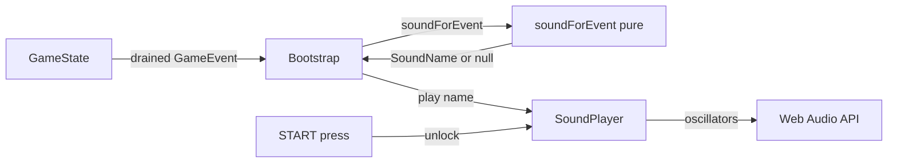

# Security Design: u3-sound

How the sound unit meets `aidlc/spaces/default/intents/261113-ai-catch-mvp/construction/u3-sound/nfr-requirements/security-requirements.md` with the stack in `aidlc/spaces/default/intents/261113-ai-catch-mvp/construction/u3-sound/nfr-requirements/tech-stack-decisions.md`. Behaviour: `aidlc/spaces/default/intents/261113-ai-catch-mvp/construction/u3-sound/functional-design/functional-spec.md`. Boundaries: C2 events and C5 `main.ts` sections in `aidlc/spaces/default/intents/261113-ai-catch-mvp/inception/contract-design/contract-summary.md`.

No stage questions were needed.

## Approach

Keep sound self-contained and fail-safe: code-defined tones only, one guarded entry point to Web Audio, a pure mapping that can be tested without audio, and nothing that can stop the game loop.

## Design Decisions

| ID | Requirement | Design | Verified by |
|---|---|---|---|
| SD3-1 | NFR5.7 | `SOUNDS` holds every cue as `Note[]`; `play` builds oscillators from them. No `fetch`, `Audio`, `decodeAudioData`, or URL anywhere in `src/audio`. | Code review (`grep`) |
| SD3-2 | NFR5.8 | `unlock` and `play` keep their existing `try/catch` bodies; `play` returns at once when there is no context. `soundForEvent` uses a `switch` with a `default` returning `null`, so unknown events are ignored. | Existing test without AudioContext; new mapping tests |
| SD3-3 | NFR5.9 | `unlock()` is called only from the START button click and the Enter/Space keydown handlers in `main.ts`, before `pressStart()`. | Code review; phone play check |
| SD3-4 | NFR5.10 | The peak gain stays the existing 0.12 per oscillator, with the existing 5 ms attack and 20 ms release envelope. Overlapping cues may sum; accepted. | Code review |
| SD3-5 | NFR6.4 | New cues are hand-written note lists (intervals and rhythms chosen for this game). `ASSETS.md` gets a "Sounds" line stating all cues are code-defined and original, with no external source. | Review of `SOUNDS` and `ASSETS.md` |
| SD3-6 | NFR8.16 | `soundForEvent(e: GameEvent): SoundName \| null` imports only the `GameEvent` type; no DOM or audio access. Tests are written first. | `npm test` |

## Data Flow

Text version: Bootstrap drains game events, asks the pure `soundForEvent` for a cue name, and tells `SoundPlayer` to play it. The first START press unlocks `SoundPlayer`, which is the only code that touches the Web Audio API.

## Residual Risk

| Risk | Impact | Accepted because |
|---|---|---|
| Browser blocks audio until a gesture | No sound before the first START | Required by browsers; the title screen needs no sound |
| Overlapping cues briefly louder | Short loudness peaks | Rare and short; peak per oscillator is low |
