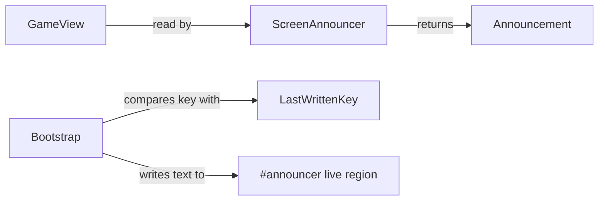

# Entities: u4-accessibility

Entities for the screen-announcement unit. Owner and shape come from ScreenAnnouncer in `aidlc/spaces/default/intents/261113-ai-catch-mvp/inception/domain-design/components.md` (ADR-004 in `decisions.md`); the read-only view from contract C1 and the `main.ts` sections from C5 in `aidlc/spaces/default/intents/261113-ai-catch-mvp/inception/contract-design/contract-summary.md`; scope from U4 in `aidlc/spaces/default/intents/261113-ai-catch-mvp/inception/units-generation/unit-of-work.md`; FR13.2 in `aidlc/spaces/default/intents/261113-ai-catch-mvp/inception/requirements-analysis/requirements.md`; texts from the Screen Announcement table in `aidlc/spaces/default/intents/261113-ai-catch-mvp/inception/refined-mockups/interaction-spec.md`. Decisions from `functional-design-questions.md` [Qn].

ScreenAnnouncer owns no stored entity (components.md: `entities: []`). The two shapes below are value objects it returns and that Bootstrap keeps for one comparison.

```yaml
entities:
  - name: Announcement
    owner: ScreenAnnouncer
    description: The text for the current screen and the key that says when it must be written again [Q2].
    identifier: none (value object)
    attributes:
      - { name: key, type: string, required: true, constraints: "'<phase>:<stageNumber>' and, in phase playing only, ':<lives>'" }
      - { name: text, type: string, required: true, constraints: "non-empty, plain text, English, no markup" }
    constraints:
      - "key does not contain the score, caught count, phaseTime, or canReturnToTitle [Q2, Q3]."
      - "Equal views give equal announcements (pure)."
  - name: LastWrittenKey
    owner: Bootstrap (announcement section of main.ts, C5)
    description: The key of the last announcement written to the live region.
    identifier: none (single value)
    attributes:
      - { name: value, type: "string or null", required: true, constraints: "null before the first write" }
```

## Inputs Read (contract C1, read-only)

| `GameView` field | Used for |
|---|---|
| `phase` | Which screen text and the key |
| `stage.stageNumber`, `stage.name`, `stage.requiredCount` | Stage wording, item names by stage number (BR1.3), and the key |
| `aiRestoration` | "AI n%" |
| `score`, `best`, `newHighScore` | Score, high score, and "New high score." |
| `caught` | "n of m" during play |
| `lives` | Lives text and the playing key |

`human`, `objects`, `phaseTime`, and `canReturnToTitle` are not read.

## Relationships



Text version: ScreenAnnouncer reads GameView and returns an Announcement. Bootstrap compares its key with LastWrittenKey and, when they differ, writes the text into the `#announcer` live region.
