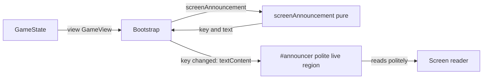

# Security Design: u4-accessibility

How the screen-announcement unit meets `aidlc/spaces/default/intents/261113-ai-catch-mvp/construction/u4-accessibility/nfr-requirements/security-requirements.md` with the stack in `aidlc/spaces/default/intents/261113-ai-catch-mvp/construction/u4-accessibility/nfr-requirements/tech-stack-decisions.md`. Behaviour: `aidlc/spaces/default/intents/261113-ai-catch-mvp/construction/u4-accessibility/functional-design/functional-spec.md`. Boundaries: C1 `GameView` and C5 `main.ts` sections in `aidlc/spaces/default/intents/261113-ai-catch-mvp/inception/contract-design/contract-summary.md`.

No stage questions were needed.

## Approach

Keep the wording pure and the DOM write tiny: a tested function turns read-only numbers and fixed names into text, and one guarded line in `main.ts` puts that text into the live region only when the key changes.

## Design Decisions

| ID | Requirement | Design | Verified by |
|---|---|---|---|
| SD4-1 | NFR5.11 | The write is `region.textContent = a.text`. The text is built only from numbers (`score`, `best`, `lives`, `caught`, `requiredCount`, `aiRestoration`, `stageNumber`) the fixed `stage.name` union, and fixed string constants in `announcer.ts` (the BR1.2 sentence parts and BR1.3 item names). No `innerHTML` or `insertAdjacentHTML` anywhere in `src/`. | Code review (search `innerHTML` in `src/`) |
| SD4-2 | NFR5.12 | `#announcer` is looked up once with `document.getElementById` (not the throwing `el()` helper). When it is null the section does nothing. The write is wrapped in `try/catch`. | Code review; play check |
| SD4-3 | NFR5.13 | `src/game/announcer.ts` imports only the `GameView` type; it has no `fetch`, storage, timer, or DOM access. | Code review |
| SD4-4 | NFR1.4, NFR5.12 | Bootstrap keeps `let lastKey: string \| null = null` and an `announce()` function called after `renderer.draw`. Inside one `try/catch`, it calls `screenAnnouncement(state.view)` and, if `a.key !== lastKey`, writes and sets `lastKey = a.key`. Both the build and the write are inside the guard, so a builder error can never stop the `requestAnimationFrame` loop. The key holds no score, caught count, or time, so the DOM is touched only on a screen or life change. | Key unit tests; code review that the guard covers both calls |
| SD4-5 | NFR8.20 | `screenAnnouncement(view: GameView): Announcement` takes the C1 type only (it cannot call input or time methods). Tests are written first and recorded failing. | `npm test`; type check; the code-generation plan puts the Red step before Green and records the failing output |
| SD4-6 | NFR2.4 | No asset or dependency; only one new source file and a few lines in `main.ts`. | Build size in Code Generation |

## Data Flow

Text version: each frame Bootstrap passes the read-only view to the pure builder and gets a key and text back. Only when the key differs from the last one does it set the live region's `textContent`, which the screen reader then reads politely.

## Residual Risk

| Risk | Impact | Accepted because |
|---|---|---|
| A screen reader may skip a text if two changes come within a moment (e.g. a life lost right before game over) | The first text may be cut off; the later one is read | Polite regions read the latest text; the game-over text carries the outcome |
| Screen-reader behaviour differs by browser | Wording may be read slightly differently | Should Have (FR13.2); play-checked with VoiceOver |
