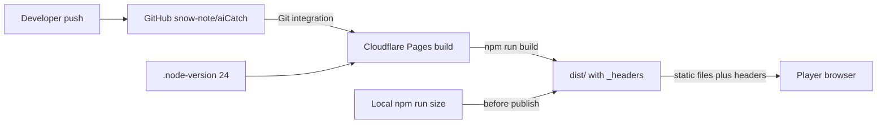

# Security Design: u5-publishing

How the publishing unit meets `aidlc/spaces/default/intents/261113-ai-catch-mvp/construction/u5-publishing/nfr-requirements/security-requirements.md` with the stack in `aidlc/spaces/default/intents/261113-ai-catch-mvp/construction/u5-publishing/nfr-requirements/tech-stack-decisions.md`. Build contract: C6 in `aidlc/spaces/default/intents/261113-ai-catch-mvp/inception/contract-design/contract-summary.md`.

U5 is a `packaging` unit with no `functional-spec.md` of its own; the behaviour it publishes is fixed by the U1-U4 functional specs (for example `aidlc/spaces/default/intents/261113-ai-catch-mvp/construction/u1-game-rules/functional-design/functional-spec.md`), and this design changes none of it.

No stage questions were needed.

## Approach

Publish exactly what `npm run build` produces, from files that live in the repository: a pinned Node version, a headers file that locks the page to its own origin, a dependency-free size gate, and a README that carries the release checklist. Nothing runs on a server.

## Design Decisions

| ID | Requirement | Design | Verified by |
|---|---|---|---|
| SD5-1 | NFR8.24, NFR7.2 | `.node-version` at the repository root containing `24`. No `engines` change in `package.json`. | Pages build log shows Node 24 |
| SD5-2 | NFR5.15, NFR8.26 | `public/_headers` (Vite's default `publicDir`, copied to `dist/_headers`) with one `/*` rule and the three headers exactly as written in NFR5.15. No `<meta>` CSP in `index.html`. | `dist/_headers` after build; `curl -sI <preview-url>`; no CSP error in the console on desktop and phone |
| SD5-3 | NFR2.5, NFR8.25 | `scripts/check-size.mjs`: exports `SIZE_LIMIT = 1048576` and the pure `checkTotal(sizes, limit = SIZE_LIMIT)` returning `{ total, ok }` with `ok = total < limit`. The CLI part runs only when the file is executed directly (`process.argv[1]` resolves to this file's path via `fileURLToPath(import.meta.url)`), so importing it in a test does no file access and never calls `process.exit`. The CLI walks `dist/` with `readdirSync(dir, { recursive: true, withFileTypes: true })`, counts only entries where `isFile()` is true (sizes from `statSync`), prints the total in bytes and KiB, and exits 0 (ok), 1 (too large), or 2 (no `dist/`: "run npm run build first"). A hand-written `scripts/check-size.d.mts` declares `export const SIZE_LIMIT: number;` and `export function checkTotal(sizes: readonly number[], limit?: number): { total: number; ok: boolean };` so the strict TypeScript test can import them (the repo has no `@types/node`). `tsconfig.json` is not changed: `scripts/` stays outside `include`, and `moduleResolution: Bundler` resolves the `.d.mts` from the test's import. `package.json` gets `"size": "node scripts/check-size.mjs"`. | `tests/tooling/check-size.test.ts` (under, at, over the limit; empty list). Not `tests/build/`: the `.gitignore` rule `build/` would ignore it. `npm run size` |
| SD5-4 | NFR5.14, NFR3.2 | No change to the game: it already loads only `index.html`, one JS, and one CSS file and calls no other origin (checked: no `fetch`, external URL, font, or image in `src/` or `dist/index.html`). The CSP of SD5-2 enforces this in the browser. | Network panel on the preview URL (only same-origin requests; load event within 2 s with Fast 4G throttling and cache disabled) |
| SD5-5 | NFR5.16 | No environment variables or secrets in the Pages project. `.gitignore` already ignores `.env` and `.env.*`; the release checklist includes `git ls-files` review for secrets. | README checklist; review |
| SD5-6 | NFR7.3, NFR6.5, NFR1.5 | New `README.md` sections: About (story and message from `product.md`), How to Play (arrow keys, START / Enter / Space, touch halves), Run Locally (`npm ci`, `npm run dev`, `npm test`, `npm run typecheck`, `npm run build`, `npm run size`), Release Checklist (typecheck, test, build, size, preview play check on desktop and phone incl. 60 fps feel and VoiceOver, network panel, headers), Publishing (Cloudflare Pages settings of NFR7.2), Assets and Originality (all original, see `ASSETS.md`), Licence (MIT). The public URL is filled in by the developer once the Pages project exists. | README review |
| SD5-7 | NFR7.1, NFR7.2, NFR8.27 | The Cloudflare and GitHub account steps are done by the developer and documented in the README Publishing section: make `snow-note/aiCatch` public; create a Pages project from it with build command `npm run build`, output `dist`, production branch `main`, previews on; leave Web Analytics off (SD5-2 would block it). | Repository page and Pages settings checked by the developer |

## Data Flow

Text version: the developer pushes to GitHub; Cloudflare Pages builds with Node 24 from `.node-version`, runs `npm run build`, and serves `dist/` with the headers from `_headers`. Before publishing, the developer runs `npm run size` locally against the same `dist/`.

## Residual Risk

| Risk | Impact | Accepted because |
|---|---|---|
| Cloudflare changes how `_headers` or `.node-version` are read | Headers or Node pin silently ignored | Checked on every preview (`curl -sI`, build log) |
| `npm run size` is a manual gate until CI exists | A large build could be published | The build is 36 KB against 1 MB; the CI Pipeline stage can run the same command |
| The developer forgets to make the repository public | NFR7 not met | Listed in the README Publishing section and the release checklist |
