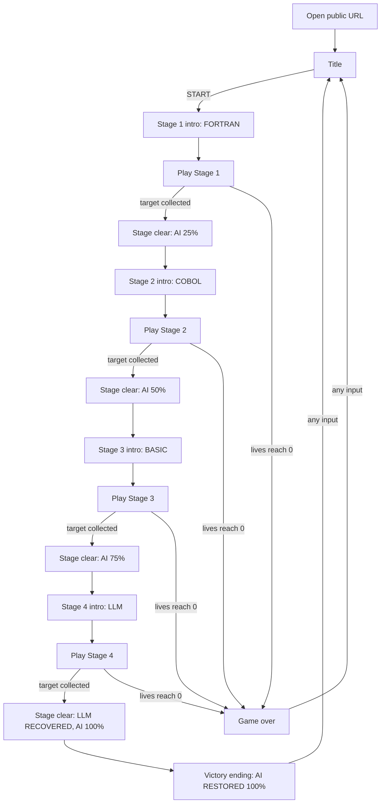

# User Flow: AI CATCH (four-stage MVP)

Based on `aidlc/spaces/default/intents/261113-ai-catch-mvp/ideation/intent-capture/intent-statement.md`, `aidlc/spaces/default/intents/261113-ai-catch-mvp/ideation/scope-definition/scope-document.md`, `aidlc/spaces/default/intents/261113-ai-catch-mvp/ideation/scope-definition/intent-backlog.md`, `rough-mockups-questions.md` (Q1, Q2), and `wireframes.md`.

## Core Flow (Happy Path)

Text version:
1. The player opens the public URL. The title screen appears at once; there is no power-on step (Q1, Q2).
2. START begins Stage 1 (FORTRAN). Each stage shows a short intro, then play.
3. Collecting the stage target clears the stage. The stage-clear screen shows AI restoration rising by 25%, then the next stage intro follows.
4. Clearing Stage 4 (LLM) shows "LLM RECOVERED" with AI reaching 100%, then the victory ending. In Stage 4, LLM, GPU, and ROBOT count together toward one target.
5. Lives carry over from stage to stage for the whole run. If lives reach 0 in any stage, game over appears.
6. From the victory ending or game over, any input returns to the title. A new run always starts from Stage 1 (Q2).

## Decision Points

| Point | Condition | Goes to |
|---|---|---|
| During play | Stage target collected | Stage clear (after Stage 4, stage clear then the victory ending) |
| During play | Lives reach 0 | Game over |
| Victory ending / game over | Score beats the high score | High score is updated and shown |
| Victory ending / game over | Any input | Title |

## Inputs Per Screen

| Screen | Keyboard | Touch |
|---|---|---|
| Title | Enter / Space = START | Tap START |
| Stage intro, stage clear | None (advance on their own) | None |
| Playing | Left / right arrow keys | Left / right half of the screen |
| Game over, victory ending | Any key | Any tap |

## Pause

The game has no pause (gate decision R-09).

## Error and Edge Paths

- **Local storage unavailable:** the high score works for the session only; the game continues (existing behaviour kept).
- **Sound unavailable or blocked:** the game continues without sound.
- **Screen rotated on a smartphone:** the console re-fits; play continues.

## Assumptions & Open Questions

- [assumption] What happens when the browser tab loses focus during play, and how long the auto-advancing stage intro and stage clear screens stay up, are decided in a later design or balancing stage (gate decision R-09).
- [assumption] Whether a held key from play should be ignored on the game-over and ending screens (to avoid skipping them by accident) is decided in a later design stage.
