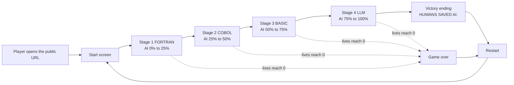

# Scope Document: AI CATCH (four-stage MVP)

Inputs: `aidlc/spaces/default/intents/261113-ai-catch-mvp/ideation/intent-capture/intent-statement.md` (intent statement), `aidlc/spaces/default/intents/261113-ai-catch-mvp/ideation/feasibility/feasibility-assessment.md` (feasibility assessment), `aidlc/spaces/default/intents/261113-ai-catch-mvp/ideation/feasibility/constraint-register.md` (constraint register), `scope-definition-questions.md` (answers Q1-Q5), and `.kiro/steering/product.md` §10 (authoritative MVP scope).

## Scope Statement

The MVP is the complete four-stage AI CATCH game described in `product.md`. A player starts the game, recovers computing history through the FORTRAN, COBOL, and BASIC stages, rebuilds modern AI in the LLM stage, restores AI to 100%, and sees the victory ending. The game is public at a URL before the hackathon submission. (Q1, Q5)

## In Scope (Must-have)

All of the following are required for the MVP (Q1, Q2):

| # | Capability |
|---|---|
| S1 | Start screen |
| S2 | Four-stage progression: FORTRAN, COBOL, BASIC, LLM |
| S3 | HUMAN moves left and right and catches falling objects |
| S4 | Stage-specific collectibles: mainframe computers (FORTRAN), magnetic tapes (COBOL), floppy disks (BASIC), LLM / GPU / ROBOT (LLM) |
| S5 | VIRUS enemies in every stage |
| S6 | Score |
| S7 | Lives and game over |
| S8 | Difficulty rises from stage to stage |
| S9 | AI restoration progress from 0% to 100%, +25% per completed stage |
| S10 | Stage completion feedback that names the recovered generation and the new AI restoration level |
| S11 | Victory ending: "AI RESTORED — 100%", "HUMANS SAVED AI.", "SAVE THE AI. SAVE THE FUTURE." |
| S12 | Restart |
| S13 | Original retro LCD-style visuals and original sound effects |
| S14 | Keyboard (left and right arrow keys) and mobile touch controls |
| S15 | Local high score |
| S16 | The game is deployed and playable at a public URL (GitHub source, Cloudflare Pages hosting) |

## Nice-to-have (only if time remains)

These are built only after every must-have item works, and they may be dropped (Q2):

- Extra LCD flicker, glitch, and corruption effects beyond the basic ones
- Richer stage transition and victory animations
- Different falling movement per object type

## Out of Scope

From the intent statement and the scope guardrails:

- Rankings and leaderboards, user accounts, online multiplayer
- Backend services and databases
- External AI APIs
- Any feature that does not support the core game experience

From `original_spec.md` ideas that `product.md` does not include: world ranking, daily shared challenges, play history, result sharing, and Ghost Replay.

## Value Stream

Text version: the player opens the public URL and reaches the start screen. Each completed stage raises AI restoration by 25%: FORTRAN to 25%, COBOL to 50%, BASIC to 75%, LLM to 100%. Completing the LLM stage shows the victory ending. Losing all lives in any stage leads to game over. Both the ending and game over lead to restart and back to the start screen.

## Sequencing and Dates

- **Order: value first (Q4).** Make the whole game playable from start screen to victory ending first, with simple visuals. Then add stage feedback, art, sound, and polish.
- **Dependencies (Q3):** stage progression and AI restoration come first. Stage collectibles, stage feedback, per-stage difficulty, and the ending depend on them. Visual and sound polish depend on the screens existing.
- **Internal feature-complete date: 2026-11-30 (Q5).** All must-have items work and the game is deployed.
- **Submission deadline: 2026-12-04 2:00 PM PT (Q5, constraint OC2).** The demo video, the English description, and the Kiro write-up are prepared between 2026-11-30 and the deadline.

## Timeline Check

From 2026-11-13 to the 2026-11-30 feature-complete date is 17 days. The feasibility assessment rates the work as feasible by extending the existing game, which already covers movement, catching, VIRUS, lives, score, high score, controls, screen scaling, and sound. The new work is S2, S4, S8 to S11, and the new collectible art. If the 2026-11-30 date is at risk, drop the nice-to-have items first.

## Assumptions & Open Questions

None.
