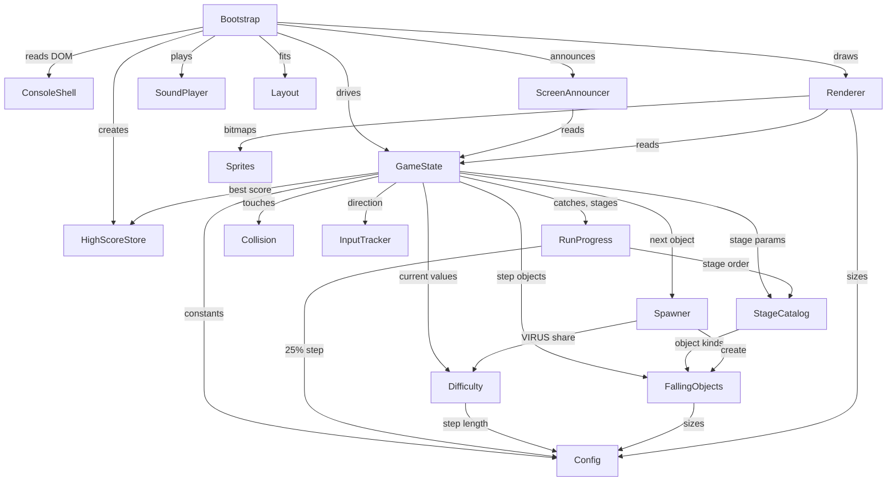

# Component Catalogue: AI CATCH (four-stage MVP)

Logical building blocks for the four-stage MVP. The catalogue extends the existing components found by reverse engineering (`aidlc/spaces/default/codekb/aiCatch/architecture.md`, `aidlc/spaces/default/codekb/aiCatch/component-inventory.md`) with three new ones (StageCatalog, RunProgress, ScreenAnnouncer), following `domain-design-questions.md` (Q1-Q5). It realises `aidlc/spaces/default/intents/261113-ai-catch-mvp/inception/requirements-analysis/requirements.md` and `aidlc/spaces/default/intents/261113-ai-catch-mvp/inception/user-stories/stories.md`, and keeps the rules in `aidlc/spaces/default/intents/261113-ai-catch-mvp/inception/practices-discovery/team-practices.md`: game rules free of DOM and drawing code, tunable numbers in `config.ts`, no unnecessary abstractions. Deployment topology and file layout are decided in later stages; files named here are where the existing code already lives.

Entities are captured at ownership-and-shape level only; types and validation belong to Functional Design.

```yaml
components:
  - name: ConsoleShell
    summary: The page's console casing, LCD bezel, canvas, START button, move hint, and hidden announcement element.
    behaviour: >
      Static markup and styling. Silver-grey casing with the "AI CATCH" label as the page's only top-level heading,
      a main landmark around the console, the 240 x 160 canvas, the "MOVE" hint text, and the START button.
      The POWER button is removed. Holds an empty, visually hidden polite live region for screen-level announcements.
    responsibilities:
      - Console look (casing colour, label, bezel, controls row)
      - Page structure for accessibility (single h1, main landmark, live region element)
    depends_on: []
    dependents:
      - component: Bootstrap
        interaction: finds the canvas, START button, and live region; applies the fitted scale
    external_dependencies: []
    entities: []

  - name: Bootstrap
    summary: Composition root that wires the browser to the game.
    behaviour: >
      Creates GameState with the high-score store and random source, runs the fixed-step animation loop,
      forwards keyboard, pointer, and START button input to GameState (a START button activation is not also counted as a key press),
      drains game events to Renderer effects and SoundPlayer cues, unlocks sound on the first START press,
      re-fits the console on resize and rotation via Layout, and writes ScreenAnnouncer text into the live region only when it changes.
      Holds no game rules.
    responsibilities:
      - Input wiring (keys, touch halves, START button)
      - Main loop and event fan-out to drawing and sound
      - Writing the announcement text to the DOM
    depends_on:
      - component: ConsoleShell
        interaction: reads DOM elements and applies the console transform
        style: sync
      - component: GameState
        interaction: forwards input, advances time, reads state, drains events
        style: sync
      - component: Renderer
        interaction: draws each frame and starts effects on events
        style: sync
      - component: SoundPlayer
        interaction: plays sound cues on events; unlocked on first START
        style: sync
      - component: HighScoreStore
        interaction: creates the store and injects it into GameState
        style: sync
      - component: Layout
        interaction: computes the console scale and offset for the visible area
        style: sync
      - component: ScreenAnnouncer
        interaction: builds the announcement text from the current state
        style: sync
    dependents: []
    external_dependencies:
      - name: Browser DOM and requestAnimationFrame
        kind: other
        purpose: page elements, input events, frame timing
    entities: []

  - name: GameState
    summary: The game's screen phases and moment-to-moment play rules.
    behaviour: >
      Phase machine: title -> stage-intro -> playing -> stage-clear -> (next stage-intro | victory), and playing -> game-over;
      game-over and victory return to title on a new press after their sequence. The power-off and startup phases are removed.
      Stage-intro and stage-clear advance on their own timers and ignore input; nothing spawns or moves in them.
      HUMAN returns to the bottom centre when play starts; a direction held across intro -> playing moves at once.
      During play: moves HUMAN from InputTracker, spawns objects using Difficulty and Spawner with the current stage's parameters,
      steps objects, resolves at most one touched object per update (VIRUS first), adds points, removes a life per VIRUS,
      lets missed collectibles vanish with no penalty, and asks RunProgress to record catches. When RunProgress reports the target
      reached, all falling objects are removed, the clear bonus is added, and the phase becomes stage-clear. When lives reach 0 the phase
      becomes game-over. The high score is submitted at game over and at victory. Score and lives carry across stages; a new run resets them.
      Emits events (catch, virus-hit, life-lost, stage-start, stage-clear, victory, game-over) for drawing and sound.
    responsibilities:
      - Screen phases and their timers
      - Play rules (movement, spawning, catching, VIRUS, lives, score)
      - Event queue for drawing and sound
    depends_on:
      - component: RunProgress
        interaction: records catches, asks whether the stage is cleared, advances stages, reads AI restoration
        style: sync
      - component: StageCatalog
        interaction: reads the current stage's collectibles, difficulty values, and clear bonus
        style: sync
      - component: Difficulty
        interaction: gets spawn interval, speed, VIRUS share, and object cap for the current stage and time in stage
        style: sync
      - component: Spawner
        interaction: picks the next object kind and position from the stage's collectibles and VIRUS share
        style: sync
      - component: FallingObjects
        interaction: creates and steps falling objects, checks the bottom
        style: sync
      - component: Collision
        interaction: finds touched objects and the one to handle
        style: sync
      - component: InputTracker
        interaction: current direction and new-press detection
        style: sync
      - component: HighScoreStore
        interaction: reads the best score; submits the final score at game over and victory
        style: sync
      - component: Config
        interaction: sizes, speeds, points, lives, screen durations
        style: sync
    dependents:
      - component: Bootstrap
        interaction: drives it each frame
      - component: Renderer
        interaction: reads it to draw
      - component: ScreenAnnouncer
        interaction: reads it to build announcement text
    external_dependencies: []
    entities:
      - name: GameSession
        identifier: session (one per page load)
        attributes: [phase, phaseTime, score, lives, newHighScore, human, objects, events]
        references:
          - entity: Run
            owned_by: RunProgress
            relationship: each GameSession holds the current Run
          - entity: FallingObject
            owned_by: FallingObjects
            relationship: a GameSession holds the objects currently falling

  - name: RunProgress
    summary: The current run's position in the four-stage story and its AI restoration.
    behaviour: >
      Starts a run at Stage 1 with progress 0 and AI 0%. Each catch of a current-stage collectible adds 1 to progress
      (in Stage 4, LLM, GPU, and ROBOT add to one combined count). Reaching the stage's required count clears the stage and
      raises AI restoration by exactly 25%. After Stages 1-3 the run moves to the next stage with progress 0; after Stage 4 (AI 100%)
      the run is complete (victory). Missed collectibles do not change progress. Has no knowledge of screens, drawing, or time.
    responsibilities:
      - Stage index and order (FORTRAN, COBOL, BASIC, LLM)
      - Progress toward the stage target
      - AI restoration percentage and run completion
    depends_on:
      - component: StageCatalog
        interaction: reads stage order, collectibles, and required counts
        style: sync
      - component: Config
        interaction: reads the restoration step (25%)
        style: sync
    dependents:
      - component: GameState
        interaction: records catches and advances stages
    external_dependencies: []
    entities:
      - name: Run
        identifier: run (one per play from title to game over or victory)
        attributes: [stageIndex, caught, aiRestoration, complete]
        references:
          - entity: StageDefinition
            owned_by: StageCatalog
            relationship: a Run is on exactly one StageDefinition at a time

  - name: StageCatalog
    summary: Fixed definitions of the four stages, kept in config.ts.
    behaviour: >
      Read-only table of the four stages in order. Each stage has a number, a display name, the collectible kinds that count
      toward its target, a required count, starting difficulty values and in-stage caps (fall speed, spawn interval, VIRUS share,
      maximum objects on screen), and a clear bonus. Later stages are equal or harder on every difficulty value and strictly harder on at least one.
      All numbers are starting values tuned by playtesting.
    responsibilities:
      - Stage data (names, collectibles, targets, difficulty values, bonus)
    depends_on:
      - component: FallingObjects
        interaction: uses the object kinds to name each stage's collectibles
        style: sync
    dependents:
      - component: GameState
        interaction: reads the current stage's parameters
      - component: RunProgress
        interaction: reads stage order and targets
    external_dependencies: []
    entities:
      - name: StageDefinition
        identifier: stageNumber
        attributes: [stageNumber, name, collectibles, requiredCount, difficultyStart, difficultyCap, clearBonus]

  - name: Config
    summary: General tunable constants for the whole game.
    behaviour: >
      Sizes, HUMAN speed, points per object kind, starting lives, difficulty step length, screen durations
      (stage intro, stage clear, game-over and victory sequences), and the AI restoration step. No logic.
    responsibilities:
      - One place for every general tunable number
    depends_on: []
    dependents:
      - component: GameState
        interaction: reads play and screen constants
      - component: RunProgress
        interaction: reads the restoration step
      - component: Difficulty
        interaction: reads the step length
      - component: FallingObjects
        interaction: reads sizes and motion constants
      - component: Renderer
        interaction: reads sizes and screen durations
    external_dependencies: []
    entities: []

  - name: Difficulty
    summary: Turns a stage's difficulty values and time in stage into current spawn and speed values.
    behaviour: >
      Pure functions. Given the current stage's starting values and caps and the seconds spent in that stage, returns the spawn
      interval, fall-speed multiplier, VIRUS share, and maximum objects on screen. Values rise in steps over time and stop at the
      stage's cap. Knows nothing about stage numbers.
    responsibilities:
      - In-stage difficulty curve
    depends_on:
      - component: Config
        interaction: reads the step length
        style: sync
    dependents:
      - component: GameState
        interaction: asks for current values each update
      - component: Spawner
        interaction: uses the current VIRUS share
    external_dependencies: []
    entities: []

  - name: Spawner
    summary: Chooses what falls next and where.
    behaviour: >
      Given the current stage's collectible kinds, the current VIRUS share, and an injectable random source, picks VIRUS or one of the
      collectibles (equal shares among collectibles) and a horizontal position inside the play area. Knows nothing about stage numbers.
    responsibilities:
      - Next object kind and position
    depends_on:
      - component: Difficulty
        interaction: current VIRUS share
        style: sync
      - component: FallingObjects
        interaction: creates the object
        style: sync
    dependents:
      - component: GameState
        interaction: asks for the next object when the spawn timer fires
    external_dependencies: []
    entities: []

  - name: FallingObjects
    summary: Object kinds and how each falls.
    behaviour: >
      Defines every object kind (mainframe, magnetic tape, floppy disk, LLM, GPU, ROBOT, VIRUS), creates objects, steps their motion
      (straight falls for most kinds, existing ROBOT sway and VIRUS jitter kept), and checks when an object leaves the bottom.
      New kinds fall straight; different movement for new kinds is out of scope.
    responsibilities:
      - Object kinds and motion
    depends_on:
      - component: Config
        interaction: sizes and motion constants
        style: sync
    dependents:
      - component: GameState
        interaction: steps and checks objects
      - component: StageCatalog
        interaction: names stage collectibles by kind
      - component: Spawner
        interaction: creates objects
    external_dependencies: []
    entities:
      - name: FallingObject
        identifier: order (spawn sequence number)
        attributes: [order, kind, x, y, w, h, speedMultiplier]

  - name: Collision
    summary: Finds which falling objects HUMAN touches and which one to handle.
    behaviour: >
      Bounding-box overlap. At most one object is handled per update: a VIRUS if any is touched, otherwise the earliest spawned;
      every other touched object is removed with no effect.
    responsibilities:
      - Touch detection and single-object resolution
    depends_on: []
    dependents:
      - component: GameState
        interaction: resolves touches each update
    external_dependencies: []
    entities: []

  - name: InputTracker
    summary: Tracks held keys and touches and the current move direction.
    behaviour: >
      The most recently pressed held direction wins; releasing it falls back to a direction still held. Detects new presses so a key held
      from play does not count as a new press on game over or victory. All held inputs are cleared when the window loses focus.
    responsibilities:
      - Held inputs, direction, new-press detection
    depends_on: []
    dependents:
      - component: GameState
        interaction: reads direction and new presses
    external_dependencies: []
    entities:
      - name: HeldInput
        identifier: inputId (key code or pointer id)
        attributes: [inputId, direction, pressOrder]

  - name: HighScoreStore
    summary: Keeps the best score on the device.
    behaviour: >
      Loads the stored best score (an invalid value counts as 0) and saves a higher one. If storage cannot be read or written,
      keeps the best score in memory for the session and raises no error.
    responsibilities:
      - Best score persistence with safe fallback
    depends_on: []
    dependents:
      - component: Bootstrap
        interaction: creates it with browser storage
      - component: GameState
        interaction: reads and submits scores
    external_dependencies:
      - name: Browser localStorage
        kind: other
        purpose: store the best score on the device
    entities:
      - name: HighScore
        identifier: storageKey
        attributes: [storageKey, best]

  - name: ScreenAnnouncer
    summary: Builds the short screen-reader text for the current screen.
    behaviour: >
      Pure function from the game state to a short text naming the screen and its key values (for example "Stage 1 FORTRAN, AI 0%,
      score 300, 3 of 10, 3 lives"). The text changes on entering a screen and when lives change during play, not on every score change.
      No DOM access; Bootstrap writes the result.
    responsibilities:
      - Announcement text per screen
    depends_on:
      - component: GameState
        interaction: reads phase, stage, AI restoration, score, progress, lives, high score
        style: sync
    dependents:
      - component: Bootstrap
        interaction: writes the text into the live region
    external_dependencies: []
    entities: []

  - name: Renderer
    summary: Draws every screen on the LCD canvas.
    behaviour: >
      Reads GameState only. Draws the title (story lines, sprites row, high score), stage intro, playing screen with the extended HUD
      (stage name, AI %, score, progress, lives), stage clear with the AI bar fill, game over (AI bar, REACHED STAGE line, NEW! marker),
      and the victory sequence (reboot, restore, messages, hold) with the AI face. Shares one AI restoration bar drawing across screens.
      Keeps the existing catch, VIRUS, and life-lost effects. Uses only the two LCD tones plus faint unlit pixels.
    responsibilities:
      - All LCD drawing and visual effects
    depends_on:
      - component: GameState
        interaction: reads the state to draw
        style: sync
      - component: Sprites
        interaction: bitmaps, font, seven-segment table
        style: sync
      - component: Config
        interaction: sizes and screen durations
        style: sync
    dependents:
      - component: Bootstrap
        interaction: calls it each frame and on events
    external_dependencies:
      - name: Canvas 2D API
        kind: other
        purpose: drawing
    entities: []

  - name: Sprites
    summary: Original pixel-art bitmaps, pixel font, and seven-segment table.
    behaviour: >
      Holds the existing HUMAN, LLM, GPU, ROBOT, VIRUS, and heart bitmaps, plus new mainframe, magnetic tape, floppy disk, and the AI face
      in broken and restored looks; extends the 3 x 5 font with %, ., :, a dash, and / if missing. Every object is recognisable by outline alone.
    responsibilities:
      - Original bitmaps and glyphs
    depends_on: []
    dependents:
      - component: Renderer
        interaction: draws with them
    external_dependencies: []
    entities:
      - name: Bitmap
        identifier: name
        attributes: [name, rows]

  - name: Layout
    summary: Fits the console to the visible area.
    behaviour: >
      Computes the largest scale that fits the 320 x 240 console into the visible area while keeping its aspect ratio, and the offset
      that centres it.
    responsibilities:
      - Scale and centring
    depends_on: []
    dependents:
      - component: Bootstrap
        interaction: re-fits on resize and rotation
    external_dependencies: []
    entities: []

  - name: SoundPlayer
    summary: Original synthesized sound cues.
    behaviour: >
      Note-list table and Web Audio square-wave playback. Keeps the existing game-start, per-kind catch, VIRUS, and game-over sounds; adds
      catch tones for mainframe, magnetic tape, and floppy disk, a stage-clear sound, and a victory sound; removes the startup sound.
      Any audio failure is swallowed so the game runs silently.
    responsibilities:
      - Sound cue table and playback
    depends_on: []
    dependents:
      - component: Bootstrap
        interaction: plays cues on events
    external_dependencies:
      - name: Web Audio API
        kind: other
        purpose: sound synthesis
    entities:
      - name: SoundCue
        identifier: name
        attributes: [name, notes]
```

## Component Diagram



Text version: Bootstrap uses ConsoleShell, GameState, Renderer, SoundPlayer, HighScoreStore, Layout, and ScreenAnnouncer. GameState uses RunProgress, StageCatalog, Difficulty, Spawner, FallingObjects, Collision, InputTracker, HighScoreStore, and Config. RunProgress uses StageCatalog and Config. StageCatalog uses FallingObjects. Difficulty uses Config. Spawner uses Difficulty and FallingObjects. FallingObjects uses Config. ScreenAnnouncer and Renderer read GameState; Renderer also uses Sprites and Config. The graph has no cycles.

## Component Summary

| Component | Purpose | Depends On | Dependents | Entities Owned |
|---|---|---|---|---|
| ConsoleShell | Casing, canvas, START, hint, live region | — | Bootstrap | — |
| Bootstrap | Composition root, input, loop, events | ConsoleShell, GameState, Renderer, SoundPlayer, HighScoreStore, Layout, ScreenAnnouncer | — | — |
| GameState | Screen phases and play rules | RunProgress, StageCatalog, Difficulty, Spawner, FallingObjects, Collision, InputTracker, HighScoreStore, Config | Bootstrap, Renderer, ScreenAnnouncer | GameSession |
| RunProgress (new) | Stage position, progress, AI % | StageCatalog, Config | GameState | Run |
| StageCatalog (new) | Four stage definitions | FallingObjects | GameState, RunProgress | StageDefinition |
| Config | General tunable constants | — | GameState, RunProgress, Difficulty, FallingObjects, Renderer | — |
| Difficulty | In-stage difficulty curve | Config | GameState, Spawner | — |
| Spawner | Next object and position | Difficulty, FallingObjects | GameState | — |
| FallingObjects | Object kinds and motion | Config | GameState, StageCatalog, Spawner | FallingObject |
| Collision | Touch detection and resolution | — | GameState | — |
| InputTracker | Held inputs and direction | — | GameState | HeldInput |
| HighScoreStore | Best score on device | — | Bootstrap, GameState | HighScore |
| ScreenAnnouncer (new) | Screen-reader text | GameState | Bootstrap | — |
| Renderer | LCD drawing and effects | GameState, Sprites, Config | Bootstrap | — |
| Sprites | Bitmaps, font, digits | — | Renderer | Bitmap |
| Layout | Console fit | — | Bootstrap | — |
| SoundPlayer | Sound cues | — | Bootstrap | SoundCue |

## Entity Ownership

| Entity | Owning Component | Identifier | Attributes | References |
|---|---|---|---|---|
| GameSession | GameState | session (one per page load) | phase, phaseTime, score, lives, newHighScore, human, objects, events | Run (RunProgress), FallingObject (FallingObjects) |
| Run | RunProgress | run (one per play) | stageIndex, caught, aiRestoration, complete | StageDefinition (StageCatalog) |
| StageDefinition | StageCatalog | stageNumber | stageNumber, name, collectibles, requiredCount, difficultyStart, difficultyCap, clearBonus | — |
| FallingObject | FallingObjects | order | order, kind, x, y, w, h, speedMultiplier | — |
| HeldInput | InputTracker | inputId | inputId, direction, pressOrder | — |
| HighScore | HighScoreStore | storageKey | storageKey, best | — |
| Bitmap | Sprites | name | name, rows | — |
| SoundCue | SoundPlayer | name | name, notes | — |

## External Dependencies

| Component | Dependency | Kind | Purpose |
|---|---|---|---|
| Bootstrap | Browser DOM and requestAnimationFrame | other | Page elements, input events, frame timing |
| HighScoreStore | Browser localStorage | other | Store the best score on the device |
| Renderer | Canvas 2D API | other | Drawing |
| SoundPlayer | Web Audio API | other | Sound synthesis |

No backend, database, external service, or AI API is used (NFR5).

## Rationale

| Component | Why it is a separate building block |
|---|---|
| RunProgress (new) | Distinct concern and lifecycle: the story position lives for a whole run, across several screen phases. Keeping it out of GameState keeps the stage rules ("+25%", "Stage 4 ends in victory", combined Stage 4 count) small and testable on their own (Q1, ADR-001). |
| StageCatalog (new) | Distinct change rate: stage data is tuned by playtesting while the rules stay fixed. It is data, kept in `config.ts` with the other tunables (Q1, ADR-001). |
| ScreenAnnouncer (new) | Distinct concern: accessible text derived from state. A pure function keeps it testable and keeps DOM writes in Bootstrap (Q4, ADR-004). |
| GameState | Owns the screen phases and play rules; extended rather than split, because the new screens share its timing and event queue (Q3, ADR-003). |
| Difficulty, Spawner | Kept as small functions that receive stage parameters, so they never need to know stage numbers (Q2, ADR-002). |
| Renderer, Sprites, SoundPlayer | Existing owners extended; no new drawing or audio components, to avoid unnecessary abstraction (Q5, ADR-005). |
| ConsoleShell, Bootstrap, Layout, Collision, InputTracker, HighScoreStore, FallingObjects, Config | Existing components kept with small changes (POWER removed, new object kinds, focus-loss clearing, new constants). |

**Alternatives Rejected**: putting all stage and run logic into GameState (Q1 option B), passing stage numbers into Difficulty and Spawner (Q2 option B), Renderer-owned screen timing (Q3 option B), building announcement text inside `main.ts` (Q4 option B), and a separate victory component (Q5 option B). Reasons are recorded in `decisions.md`.
