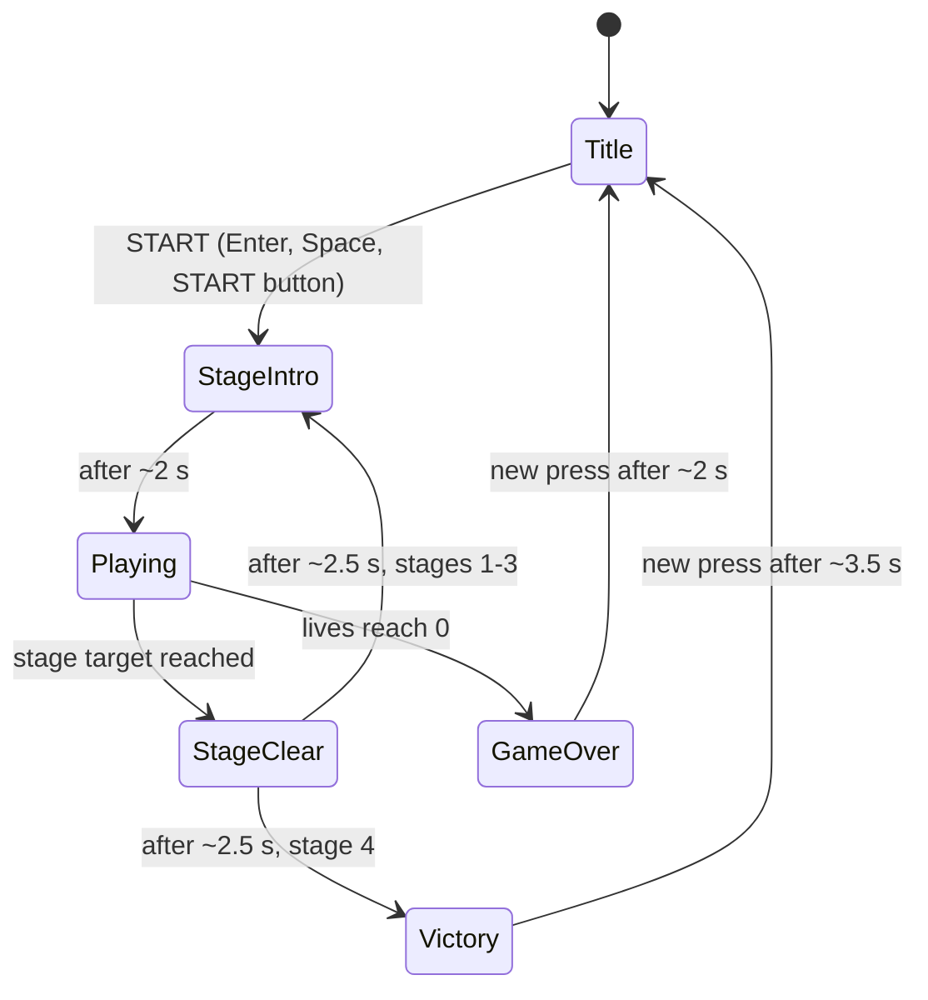

# Interaction Specification: AI CATCH (four-stage MVP)

How each screen and control behaves. Based on `mockups.md`, `aidlc/spaces/default/intents/261113-ai-catch-mvp/ideation/rough-mockups/wireframes.md` and `user-flow.md`, `aidlc/spaces/default/intents/261113-ai-catch-mvp/inception/user-stories/stories.md`, `aidlc/spaces/default/intents/261113-ai-catch-mvp/inception/requirements-analysis/requirements.md`, and `refined-mockups-questions.md`. Per `aidlc/spaces/default/intents/261113-ai-catch-mvp/inception/practices-discovery/team-practices.md`, screen timing and state changes live in the game rules (testable without a browser); drawing, sound, and DOM wiring only read the state. Times are starting values in `src/game/config.ts`.

## Screen State Machine

Text version: Title goes to Stage Intro on START. Stage Intro goes to Playing after about 2 s. Playing goes to Stage Clear when the target is reached, or to Game Over when lives reach 0. Stage Clear goes to the next Stage Intro after about 2.5 s, or to Victory after Stage 4. Game Over and Victory go back to Title on a new press, accepted only after their sequence (about 2 s and 3.5 s).

## Input Rules per Screen

| Screen | Accepted input | Ignored input | Notes |
|---|---|---|---|
| Title | Enter, Space, START button | Arrow keys, touch on the screen halves | Arrow keys do not start a run (existing behaviour) |
| Stage Intro | none | everything | Nothing falls or moves (Q5) |
| Playing | Left / Right arrow keys; touch on left / right half | Enter, Space, START | Most recently pressed direction wins |
| Stage Clear | none | everything | Nothing falls or moves (Q5) |
| Game Over | any new key press or tap, after ~2 s | presses during the sequence; keys still held from play | |
| Victory | any new key press or tap, after ~3.5 s | presses during the sequence; keys still held from play | |

Held keys: a direction key held across Stage Intro → Playing moves HUMAN as soon as play starts (no release needed, Q5). At Game Over and Victory, a key held from play does not count until released and pressed again (FR1.7).

The first START press (key, click, or tap) also unlocks sound on smartphones (FR12.3).

## Components

### Console Casing

| Field | Value |
|---|---|
| Component | Console casing |
| Description | Silver-grey frame holding the label, the LCD bezel, and the controls row |
| Category | layout |

States

| State | Description | Trigger |
|---|---|---|
| default | Casing, label, bezel, controls row | page load |
| resized | Re-fitted to the visible area, aspect kept | window resize, rotation |

Responsive behaviour

| Breakpoint | Behaviour |
|---|---|
| mobile portrait (~375 x 520 CSS px) | Whole console scaled to fit width (~1.17x) |
| mobile landscape (~667 x 320 CSS px) | Whole console scaled to fit height (~1.33x) |
| desktop | Scaled to the largest fit, centred |

Accessibility

| Requirement | Implementation |
|---|---|
| ARIA role | `main` landmark around the console |
| Label | Casing label "AI CATCH" is the page's only `h1` |
| Contrast | Dark label on silver-grey; see `design-system-mapping.md` |
| Screen reader | Hidden live region carries the screen announcement (below) |
| Focus management | Focus starts on the page; no focus trap |

### START Button

| Field | Value |
|---|---|
| Component | START button |
| Description | Starts a run from the title; also counts as "any press" at Game Over and Victory |
| Category | input |

States

| State | Description | Trigger |
|---|---|---|
| default | Raised button | page load |
| hover | Pointer cursor | mouseover |
| focus | Visible focus ring | Tab |
| active | Pressed down by 2 px | press |

Props / inputs

| Prop | Type | Required | Default | Description |
|---|---|---|---|---|
| label | string | yes | "START" | Visible text |

Accessibility

| Requirement | Implementation |
|---|---|
| ARIA role | native `button` |
| Keyboard interaction | Tab to focus, Enter / Space to activate |
| Label | visible text "START" |
| Contrast | Light text on dark blue button |
| Screen reader | "START, button" |
| Focus management | Focus stays on the button; game input still works |

### Move Hint

| Field | Value |
|---|---|
| Component | "◀ ▶ MOVE" hint text |
| Description | Tells the player how to move; not interactive (Q1) |
| Category | display |

Accessibility: plain text, not a control; the hidden live region explains the controls on the title announcement.

### LCD Canvas

| Field | Value |
|---|---|
| Component | LCD canvas (240 x 160) |
| Description | Draws every game screen |
| Category | display |

States follow the screen state machine. Touch on the left or right half of the window moves HUMAN during play (FR2.2). The canvas has `aria-hidden` content for screen readers replaced by the live region below.

### Screen Announcement (hidden live region)

| Field | Value |
|---|---|
| Component | Screen announcement |
| Description | Hidden text that tells screen readers which screen shows and its key values (FR13.2, Should Have) |
| Category | feedback |

| Screen | Text announced (example) | When |
|---|---|---|
| Title | "AI CATCH. Press Start. Arrow keys to move. High score 1200." | on entering |
| Stage Intro | "Stage 1, FORTRAN. Collect 10 mainframes. Avoid virus. AI 0%." | on entering |
| Playing | "Stage 1 FORTRAN, AI 0%, score 300, 3 of 10, 3 lives" | on entering, and when lives change |
| Stage Clear | "FORTRAN recovered. AI 25%." | on entering |
| Game Over | "Game over. AI 50%. Score 2400. High score 3100." | on entering |
| Victory | "AI restored, 100%. Humans saved AI. Save the AI, save the future. Score 4800." | on entering |

The text is built by a pure function from the game state, so it can be unit-tested. It is a polite live region; it is not updated on every score change, to avoid flooding the screen reader.

## Motion and Timing

| Event | Effect | Duration (starting value) |
|---|---|---|
| Catch | "+points" pop-up rises, spark, HUMAN flashes inverted | pop-up 0.8 s, spark 0.28 s, flash 0.16 s (existing) |
| VIRUS hit | Glitch slices and noise lines | 0.45 s (existing) |
| Life lost | Blinking frame, last heart blinks | 1.0 s (existing) |
| Stage intro | Static screen | ~2.0 s |
| Stage clear | AI bar fills by 25% | bar fill ~1.0 s inside ~2.5 s |
| Game over | Sequence, then "PRESS ANY KEY" | ~2.0 s (existing) |
| Victory | Reboot → restore → messages → hold | ~3.5 s, then "PRESS ANY KEY" |
| Blinking prompts | "PRESS START", "PRESS ANY KEY", "NEW!" | 1 Hz (existing pattern) |

## Sound Cues

| Event | Sound |
|---|---|
| Run start | Existing game-start sound |
| Catch | Existing per-kind catch sounds for LLM, GPU, ROBOT; new short tones for mainframe, magnetic tape, floppy disk |
| VIRUS hit | Existing VIRUS sound |
| Stage clear | New rising arpeggio (original) |
| Victory | New longer fanfare (original), timed with the reboot sequence |
| Game over | Existing game-over sound |

All sounds are synthesized square waves through Web Audio; if sound cannot play, the game runs silently (FR12.4).

## Screen States Beyond the Happy Path

| Condition | Behaviour |
|---|---|
| Local storage unavailable | High score kept for the session; no error shown |
| Sound blocked or unavailable | Silent play; no error shown |
| Smartphone rotated mid-run | Layout re-fits; run continues |
| Tab hidden during play | No pause logic; the browser may stop updates while hidden (assumption A2 in `requirements.md`) |
