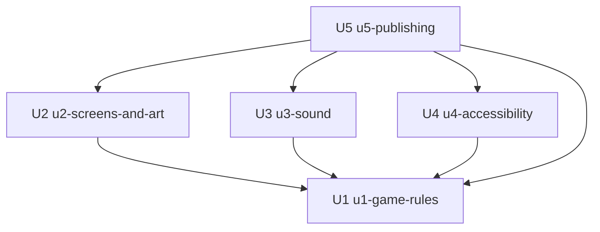

# Unit Dependencies: AI CATCH (four-stage MVP)

Topology only, for the units in `unit-of-work.md` (built from `aidlc/spaces/default/intents/261113-ai-catch-mvp/inception/domain-design/components.md` and `aidlc/spaces/default/intents/261113-ai-catch-mvp/inception/domain-design/decisions.md`; requirements in `aidlc/spaces/default/intents/261113-ai-catch-mvp/inception/requirements-analysis/requirements.md`, stories in `aidlc/spaces/default/intents/261113-ai-catch-mvp/inception/user-stories/stories.md`). It does not choose a build order; Delivery Planning does.

## Dependency Graph



Text version: U2, U3, and U4 each depend on U1. U5 depends on U1, U2, U3, and U4. U1 depends on nothing. There are no cycles.

## Edges and Reasons

| Unit | Depends on | Why |
|---|---|---|
| U1 u1-game-rules | — | Pure game logic; builds and tests on its own against the existing code. |
| U2 u2-screens-and-art | U1 | Draws the new phases, stage data, AI restoration, and new object kinds that U1 defines. |
| U3 u3-sound | U1 | Plays cues for U1's new events (stage-clear, victory) and new object kinds. |
| U4 u4-accessibility | U1 | Builds announcement text from U1's phases, stage, AI %, progress, and lives. |
| U5 u5-publishing | U1, U2, U3, U4 | Checks and publishes the complete build, including the size budget and the README content describing all features. |

Each unit's code and tests must pass with its own code, the units it depends on, and the project as it stands.

## Integration Points

All integration is in-process within one TypeScript build (Q3). No network, no shared storage between units.

| From | To | Mechanism | What crosses |
|---|---|---|---|
| U2 | U1 | Read GameState | phase and phase time, stage definition, run progress and AI %, score, lives, high score and new-high flag, HUMAN, falling objects |
| U2, U3 | U1 | Drain GameState events (via Bootstrap) | catch (with kind), virus-hit, life-lost, stage-start, stage-clear, victory, game-over |
| U4 | U1 | Read GameState | phase, stage name, AI %, score, progress, lives, high score |
| U5 | U1-U4 | Build output | the production bundle in `dist/` |

## Parallel Development

- U1 has no dependencies.
- Once U1 is in place, **U2, U3, and U4 have no edges between them** and may be built at the same time (Q2), each in its own copy of the project.
- U5 needs all of U1-U4.

Valid orderings include U1 → U2 → U3 → U4 → U5 and U1 → {U2, U3, U4 in parallel} → U5; Delivery Planning picks one.

## Edge Block

```yaml
units:
  - name: u1-game-rules
    kind: library
    depends_on: []
  - name: u2-screens-and-art
    kind: ui
    depends_on: [u1-game-rules]
  - name: u3-sound
    kind: library
    depends_on: [u1-game-rules]
  - name: u4-accessibility
    kind: library
    depends_on: [u1-game-rules]
  - name: u5-publishing
    kind: packaging
    depends_on: [u1-game-rules, u2-screens-and-art, u3-sound, u4-accessibility]
```
