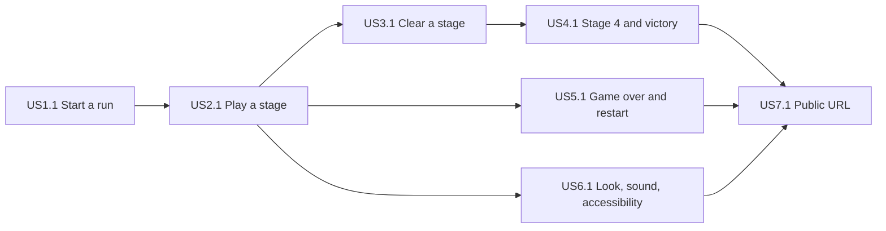

# User Stories: AI CATCH (four-stage MVP)

Source: `aidlc/spaces/default/intents/261113-ai-catch-mvp/inception/requirements-analysis/requirements.md` (FR1-FR13, NFR1-NFR9). Existing behaviour comes from the reverse-engineering knowledge base (`aidlc/spaces/default/codekb/aiCatch/business-overview.md`, `component-inventory.md`). Testing follows `aidlc/spaces/default/intents/261113-ai-catch-mvp/inception/practices-discovery/team-practices.md`: each game-logic criterion gets a failing Vitest test first; criteria marked *(play check)* are checked by playing.

Plan (from `user-stories-questions.md`): personas P1 Casual Player and P2 Hackathon Judge (`personas.md`); grouped by player journey; one large story per journey step, with the detail in the acceptance criteria; MoSCoW priorities. Numbers marked "starting value" live in `src/game/config.ts` and are tuned by playtesting.

## Summary

| ID | Story | Persona | Priority | Depends on |
|---|---|---|---|---|
| US1.1 | Start a run from the title | P1 | Must Have | — |
| US2.1 | Play a stage | P1 | Must Have | US1.1 |
| US3.1 | Clear a stage and move on | P1, P2 | Must Have | US2.1 |
| US4.1 | Finish Stage 4 and restore the AI | P2, P1 | Must Have (FR9.3 animation form, Should Have) | US3.1 |
| US5.1 | Lose, and start again | P1 | Must Have | US2.1 |
| US6.1 | See, hear, and follow the game | P1, P2 | Must Have (FR13.2 announcements, Should Have) | US2.1 |
| US7.1 | Play it anywhere from a public URL | P2, P1 | Must Have | US1.1-US6.1 |

Won't Have this release: the nice-to-have polish listed as out of scope in `requirements.md` (extra LCD flicker, glitch, and corruption effects; richer transition animations; different falling movement for new object types).

---

## Group 1: Start and Title

### US1.1 — Start a run from the title

As a **casual player (P1)**, I want the game to open straight on a clear title screen and start with one press, so that I can begin playing at once without instructions.

**Priority**: Must Have. **Requirements**: FR1, FR1.1, FR1.2, FR12.3.

Acceptance criteria:
- **AC1.1.1** — Given the page has just loaded, when it finishes loading, then the title screen is the first screen shown, with no power-off screen, POWER button, or startup sequence. *(play check)*
- **AC1.1.2** — Given the title screen, when it is shown, then it shows "AI CATCH", a one-line 2045 story text, "PRESS START", and the high score. *(play check)*
- **AC1.1.3** — Given the title screen, when the player presses Enter, Space, or the START button, then a run starts at Stage 1 with AI 0%, score 0, and 3 lives.
- **AC1.1.4** — Given the title screen, when the player presses an arrow key, then no run starts.
- **AC1.1.5** — Given a smartphone with sound not yet unlocked, when the player presses START, then sound is unlocked and plays from the first stage onward. *(play check)*

INVEST: independent of later stories; valuable on its own (the existing game already plays once started); testable through the game state's screen and run values.

---

## Group 2: Playing a Stage

### US2.1 — Play a stage

As a **casual player (P1)**, I want to move HUMAN, catch the stage's computing objects, and dodge VIRUS while the stage gets harder, so that each stage feels like a fair, rising challenge.

**Priority**: Must Have. **Requirements**: FR1.3, FR2, FR2.1, FR2.2, FR2.3, FR2.4, FR3, FR3.1, FR3.2, FR3.3, FR3.4, FR3.5, FR3.6, FR4, FR4.1, FR4.2, FR4.4, FR4.5, FR5, FR5.1, FR5.3, FR5.4, FR6, FR6.1, FR6.2, FR6.3, FR7.2, FR8, FR8.1, FR8.2.

Acceptance criteria:
- **AC2.1.1** — Given any stage begins, when the stage intro shows, then it shows the stage number and name, the collectible(s) and required count, the VIRUS, and the current AI %, and play starts on its own after about 2 s (starting value) with no input.
- **AC2.1.2** — Given Stage 1, 2, or 3, when objects fall, then the collectibles are mainframes (FORTRAN, 10 required), magnetic tapes (COBOL, 12), or floppy disks (BASIC, 14) respectively, plus VIRUS (starting values).
- **AC2.1.3** — Given Stage 4, when objects fall, then the collectibles are LLM, GPU, and ROBOT in equal shares among non-VIRUS objects, plus VIRUS, and every catch of any of the three adds 1 to one combined progress count toward 16 (starting value).
- **AC2.1.4** — Given play, when the player holds the left or right arrow key (desktop) or touches the left or right half of the screen (smartphone), then HUMAN moves that way, stops fully visible at the play-area edges, and, when both are held, follows the most recently pressed direction.
- **AC2.1.5** — Given play, when HUMAN catches a mainframe, magnetic tape, or floppy disk, then the score rises by 100 and progress by 1; when HUMAN catches an LLM, GPU, or ROBOT, then the score rises by 100, 150, or 200 and progress by 1 (starting values).
- **AC2.1.6** — Given play, when a collectible reaches the bottom uncaught, then it disappears and score, progress, and lives are unchanged.
- **AC2.1.7** — Given play, when HUMAN touches a VIRUS, then lives fall by 1, the score is unchanged, and there is no invulnerability afterwards; when a VIRUS and other objects are touched in the same update, only the VIRUS is handled.
- **AC2.1.8** — Given the configured stage values, when they are compared, then each later stage's fall speed, spawn interval, VIRUS share, and maximum objects on screen are each equal to or harder than the stage before, with at least one strictly harder.
- **AC2.1.9** — Given play within a stage, when time passes, then difficulty rises in steps from that stage's starting values up to that stage's cap, and returns to the next stage's starting values when a new stage begins.
- **AC2.1.10** — Given play, when the screen is shown, then a top bar shows the stage name, AI %, score in seven-segment digits, progress as caught/required (e.g. 3/10; one combined count in Stage 4), and lives, without covering the play area. *(play check)*
- **AC2.1.11** — Given a first-time player on Stage 1, when they play, then falls are slow and VIRUS is rare enough to clear it without prior practice. *(play check)*

INVEST: large by choice (one journey step); negotiable values are starting values; testable through the game-logic module with an injected random source.

---

## Group 3: Stage Clear and Progression

### US3.1 — Clear a stage and move on

As a **casual player (P1)** and a **hackathon judge (P2)**, I want each cleared stage to show which generation of computing I recovered and how much of the AI is restored, so that I feel the story progress as I play.

**Priority**: Must Have. **Requirements**: FR1.4, FR1.5, FR3.7, FR4.3, FR4.4, FR5.2, FR7, FR7.1.

Acceptance criteria:
- **AC3.1.1** — Given play, when the stage's required count is reached, then the stage clears at once and every object still falling disappears.
- **AC3.1.2** — Given a stage clears, when the stage-clear screen shows, then it shows "<NAME> RECOVERED" and AI restoration rising by exactly 25% (to 25%, 50%, 75%, or 100%), and advances on its own after about 2.5 s (starting value) with no input.
- **AC3.1.3** — Given a stage clears, when the score is updated, then a +500 bonus is added (starting value) and the score carries into the next stage.
- **AC3.1.4** — Given a stage clears with N lives left, when the next stage starts, then the player still has N lives (no refill) and the play area is empty.
- **AC3.1.5** — Given Stage 1, 2, or 3 clears, when the clear screen ends, then the next stage's intro shows (FORTRAN → COBOL → BASIC → LLM, in that order).

INVEST: depends on US2.1 for play; testable through stage and run values in game state.

---

## Group 4: Stage 4 and Victory

### US4.1 — Finish Stage 4 and restore the AI

As a **hackathon judge (P2)** and a **casual player (P1)**, I want completing the LLM stage to show the AI restored to 100% and the "humans saved AI" message, so that the game's story ends with a clear, memorable payoff.

**Priority**: Must Have; the exact form of the victory animation (FR9.3) is Should Have. **Requirements**: FR1, FR1.4, FR9, FR9.1, FR9.2, FR9.3, FR10.1, FR10.2.

Acceptance criteria:
- **AC4.1.1** — Given Stage 4, when its required count is reached, then the stage-clear screen shows "LLM RECOVERED" with AI 75% → 100%, and the victory ending follows it.
- **AC4.1.2** — Given the victory ending, when it shows, then it shows "AI RESTORED — 100%", "HUMANS SAVED AI.", "SAVE THE AI. SAVE THE FUTURE.", and the final score. *(play check)*
- **AC4.1.3** — Given the victory ending with a score above the stored high score, when it shows, then the stored high score is replaced and the screen shows the high score.
- **AC4.1.4** — Given the victory ending, when it shows, then a victory animation shows the AI changing from a corrupted look to a restored look. *(play check; Should Have for its exact form)*

INVEST: depends on US3.1; the run-end logic is testable; the look is checked by playing.

---

## Group 5: Game Over and Restart

### US5.1 — Lose, and start again

As a **casual player (P1)**, I want a clear game-over screen showing how far I got, and an easy way to try again, so that losing makes me want another run.

**Priority**: Must Have. **Requirements**: FR1, FR1.6, FR1.7, FR1.8, FR5.1, FR10, FR10.1, FR10.2, FR10.3.

Acceptance criteria:
- **AC5.1.1** — Given play in any stage, when lives reach 0, then the game-over screen shows the AI % reached, the score, and the high score.
- **AC5.1.2** — Given game over with a score above the stored high score, when it shows, then the stored high score is replaced.
- **AC5.1.3** — Given the game-over screen or the victory ending, when the player presses a new key or taps, then the title shows; a key still held from play does not count until it is released and pressed again.
- **AC5.1.4** — Given the title after a lost or won run, when the player starts again, then the run begins at Stage 1 with AI 0%, score 0, and 3 lives.
- **AC5.1.5** — Given local storage cannot be read or written, when a run ends, then the game keeps running, keeps the high score for the session only, and shows no error; an invalid stored value counts as 0.
- **AC5.1.6** — Given play, when the player looks for a pause, then there is none, and leaving the tab runs no pause logic.

INVEST: independent of US3.1 and US4.1 (a run can be lost in Stage 1); testable through game state and the high-score store.

---

## Group 6: Look, Sound, and Accessibility

### US6.1 — See, hear, and follow the game

As a **casual player (P1)** and a **hackathon judge (P2)**, I want an original retro LCD look, clear shapes, matching sounds, and a game I can follow with the keyboard or a screen reader, so that it feels like a polished product anyone can play.

**Priority**: Must Have; the screen-reader announcements (FR13.2) are Should Have. **Requirements**: FR2.5, FR11, FR11.1, FR11.2, FR11.3, FR11.4, FR11.5, FR12, FR12.1, FR12.2, FR12.4, FR13, FR13.1, FR13.2, NFR6, NFR9.

Acceptance criteria:
- **AC6.1.1** — Given any screen, when it shows, then it uses a monochrome grey-green LCD with dark pixels inside a silver-grey casing, with all art original and nothing modelled on Game & Watch or Nintendo. *(play check)*
- **AC6.1.2** — Given a greyscale screenshot of play, when it is viewed, then each collectible type and the VIRUS can be told apart by outline alone. *(play check)*
- **AC6.1.3** — Given the HUD and ending text, when they are drawn, then the pixel font can draw `%`, `.`, `:`, and a dash.
- **AC6.1.4** — Given play, when the player catches an object, hits a VIRUS, or loses a life, then a score pop-up and flash, a glitch effect, or a life warning shows, respectively. *(play check)*
- **AC6.1.5** — Given play, when the player catches a new collectible, clears a stage, or reaches the victory ending, then a matching original sound plays; the existing start, catch, VIRUS, and game-over sounds still play. *(play check)*
- **AC6.1.6** — Given sound cannot play, when the game runs, then it runs silently with no error.
- **AC6.1.7** — Given any screen size or a smartphone rotated mid-run, when the layout fits, then the console keeps its aspect ratio, stays centred with sharp pixels, the run is not reset, and LCD text stays readable at the smallest supported screen. *(play check)*
- **AC6.1.8** — Given the page, when it is inspected, then "AI CATCH" on the casing is the only top-level heading, and the whole game can be played with the keyboard alone.
- **AC6.1.9** — Given a screen change, when a screen reader is running, then a hidden text element announces the screen and its key values (for example "Stage 1 FORTRAN, AI 0%, score 300, 3 lives"). *(Should Have)*
- **AC6.1.10** — Given any external asset, when it is used, then its source and licence are recorded.

INVEST: large by choice; most criteria are play checks per the team practices; the screen-label text is testable as a pure function.

---

## Group 7: Platform and Publishing

### US7.1 — Play it anywhere from a public URL

As a **hackathon judge (P2)** and a **casual player (P1)**, I want to open a public URL on my desktop or phone and have the game load quickly and run smoothly with no account or server, so that I can try it immediately.

**Priority**: Must Have. **Requirements**: NFR1, NFR2, NFR3, NFR4, NFR5, NFR7, NFR8.

Acceptance criteria:
- **AC7.1.1** — Given a recent desktop browser and a recent smartphone chosen by the developer, when the game is played, then it runs smoothly with a target of 60 frames per second. *(play check)*
- **AC7.1.2** — Given the production build, when its files are measured, then everything downloaded to play is under 1 MB.
- **AC7.1.3** — Given a normal connection, when the public URL is opened, then the first screen appears within about 2 s. *(play check)*
- **AC7.1.4** — Given desktop and smartphone in portrait and landscape, when the game is shown, then the whole play area and HUD are visible without scrolling. *(play check)*
- **AC7.1.5** — Given the running game, when its network use is inspected, then it makes no server-side calls, uses no external service, and calls no AI API.
- **AC7.1.6** — Given the repository, when it is published, then it is a public GitHub repository with an open-source licence and the `/.kiro` directory committed, and the game is hosted on Cloudflare Pages at a public URL.
- **AC7.1.7** — Given the game rules, when the test suite runs, then the rules run in Vitest with no browser, every new game-logic behaviour has a test written before its implementation, and the existing tests stay green.

INVEST: depends on the other stories for content; criteria are measurable or play-checked.

---

## Dependencies

Text version: US1.1 comes first. US2.1 depends on US1.1. US3.1, US5.1, and US6.1 depend on US2.1. US4.1 depends on US3.1. US7.1 depends on US4.1, US5.1, and US6.1.
