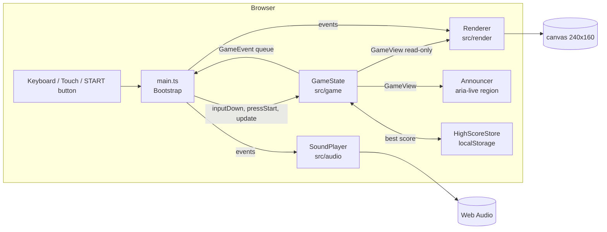
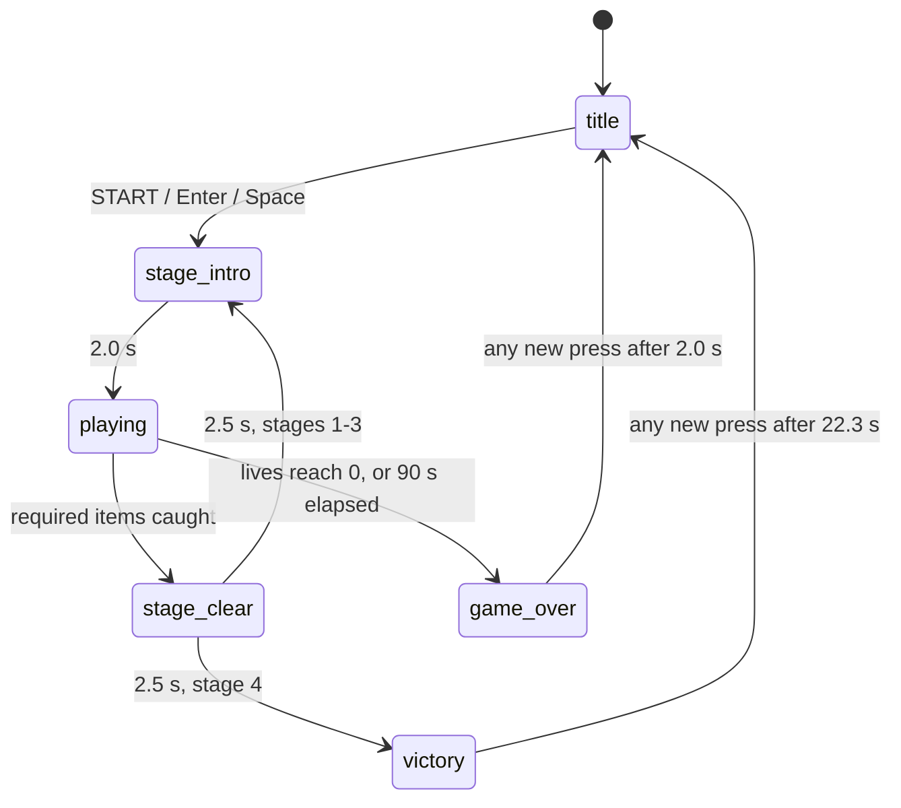
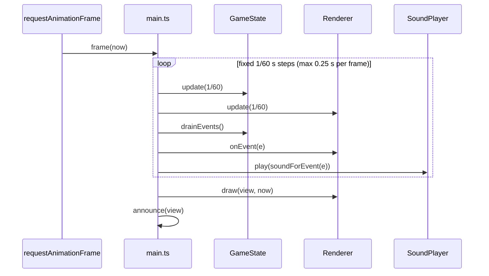

# AI CATCH Architecture

Describes the current game as of commit `5b9bed7` (all five intents after the first one are complete). Written from a read of `src/` and `index.html`. The tests were not run for this document. Update it when an intent changes behavior.

## 1. Overview

AI CATCH is a static browser game with no backend. Game rules, drawing, and sound are separate modules, wired together by `src/main.ts`.

Text fallback: input goes to `main.ts`, which drives `GameState`. `GameState` exposes a read-only `GameView` to the renderer and the announcer, and a queue of `GameEvent`s that `main.ts` forwards to the renderer effects and the sound player. The high score is kept in `localStorage`.

| Layer | Files | Rule |
|---|---|---|
| Game rules | `src/game/*.ts` | No DOM, drawing, or sound code. Methods do not throw. |
| Rendering | `src/render/*.ts` | Reads `GameView` only. Pure timing helpers live in `screen-timing.ts` and `layout.ts`. |
| Audio | `src/audio/sound.ts` | Event-to-cue mapping is pure. Playback errors are swallowed. |
| Bootstrap | `src/main.ts` | Events, loop, fitting, and announcements. |

## 2. Screen flow

The game is one phase machine in `GameState` (`src/game/state.ts`). Six phases:

`stage_intro`, `stage_clear`, and `game_over` are written with underscores only because Mermaid state names cannot contain hyphens. In code they are `'stage-intro'`, `'stage-clear'`, `'game-over'`.

| Phase | What the player sees | Leaves when |
|---|---|---|
| `title` | AI CATCH logo, sprites, 2045 story lines, HI-SCORE, blinking PRESS START | START, Enter, or Space |
| `stage-intro` | Stage number and name, items to collect and count, VIRUS to avoid, AI bar | 2.0 s |
| `playing` | HUD (stage name, `AI n%`, caught/required, lives, timer `T n`), falling objects, HUMAN | Stage cleared, 0 lives, or 90 s up |
| `stage-clear` | AI bar fills by 25 points over 1.0 s, clear bonus and time bonus | 2.5 s |
| `victory` | Reboot, AI restored, the ending message typed line by line, then SCORE and HI-SCORE | Any new press once the message has finished (22.3 s) |
| `game-over` | Reason (lives or time up), stage reached, score, new high score if any | Any new press after 2.0 s |

Returning to the title resets the run, score, and lives. The same press that returns to the title cannot also start a new run (`titleEnteredByPress`).

### Stage progression

| Stage | Name | Collectibles | Required | Fall speed x (start to cap) | Collectible speed factor |
|---|---|---|---|---|---|
| 1 | FORTRAN | mainframe | 10 | 1.0 to 1.2 | 1.2 |
| 2 | COBOL | tape | 12 | 1.3 to 1.7 | 1.3 |
| 3 | BASIC | floppy | 14 | 1.35 to 1.75 | 1.4 |
| 4 | LLM | llm, gpu, robot | 16 | 1.4 to 1.8 | 1.5 |

Each cleared stage adds 25 to AI restoration. Clearing stage 4 sets it to 100 and starts `victory`. Source: `STAGES` in `src/game/config.ts`.

## 3. Rules in `playing`

- **Movement:** left and right at 130 logical px/s inside a 240 x 160 play area.
- **Spawning:** the first object appears 0.5 s after play starts, then every `spawnInterval` seconds, up to `maxObjects` on screen. A VIRUS is chosen with probability `virusShare`. One third of VIRUS spawns are aimed at HUMAN's position at spawn time.
- **Difficulty:** every 8 s of play moves the values one quarter of the way from the stage start values to its cap, reaching the cap after 32 s (`difficulty.ts`).
- **Collectible speed:** collectibles also fall faster by the stage's collectible speed factor. VIRUS does not.
- **Collision:** bounding-box overlap. If several objects touch in one update, a VIRUS is handled first, otherwise the earliest spawned. Objects that reach the bottom vanish with no penalty.
- **Score:** 100 per mainframe, tape, floppy, or LLM; 150 per GPU; 200 per ROBOT. Clearing a stage adds 500 plus 10 per whole second left on the timer.
- **Lives:** 3. A VIRUS hit costs one life. At 0 the phase becomes `game-over` with reason `lives`.
- **Time limit:** 90 s of play per stage (`stage-intro` does not count). The timer blinks and ticks in the last 10 s. At 0 the phase becomes `game-over` with reason `time`. A clearing catch or fatal hit in the same update wins over the time-out.

## 4. Ending sequence (`victory`)

`VICTORY_DURATION` is 22.3 s. Timing comes from `phaseTime` only, using helpers in `src/render/screen-timing.ts`.

| Step | Time | Content |
|---|---|---|
| reboot | 0 to 1.5 s | Broken AI face, bar goes 75 to 100%, noise lines fall from 6 to 0 |
| restore | 1.5 to 2.5 s | Restored AI face, bar at 100% |
| messages | 2.5 to 22.3 s | `ENDING_LINES` typed out: 1.2 s per text line, 0.7 s per blank line, 60% of each step spent typing. About 19.8 s for 19 lines. The screen shows the newest lines and scrolls. |
| hold | from 22.3 s | Last lines of the message stay, with SCORE, HI-SCORE, and a blinking PRESS ANY KEY. A new press returns to the title |

The message text is in `ENDING_LINES` (`screen-timing.ts`) and matches the text in the product definition.

## 5. Per-frame loop (`main.ts`)

Text fallback: each animation frame runs zero or more fixed 1/60 s updates, forwards queued events to effects and sound, draws once, and updates the screen-reader text.

## 6. Events

`GameState` queues these events; `main.ts` drains them each step (`src/game/types.ts`).

| Event | Effect | Sound cue |
|---|---|---|
| `run-start` | Clears renderer effects | `game-start` |
| `stage-start` | none | none |
| `catch` | Score popup, spark, flash | `catch-<kind>` |
| `virus-hit` | Glitch | `virus-hit` |
| `life-lost` | Warning | none |
| `stage-clear` | none | `stage-clear` |
| `time-warning` | none | `time-tick` |
| `victory` | none | `victory` |
| `game-over` | none | `game-over` |

All cues are square-wave note lists generated with the Web Audio API. The audio context is created on the first START press, because browsers require a user gesture.

## 7. Input

| Source | Action |
|---|---|
| Left / Right arrow | Move |
| Enter, Space, START button | Start; return to title when allowed |
| Touch left or right half of the casing | Move left or right |
| Mouse click | No direction. Only returns to the title after `game-over` or `victory` |

Held keys and touches are released when the window loses focus or when the device flips between portrait and landscape. Page scrolling, pinch, and the context menu are blocked.

## 8. Layout and orientation

The casing is a fixed 320 x 240 logical box. `main.ts` (`refit`) scales it to the largest size that fits the visible area minus the safe-area insets, centred.

- The viewport comes from `visualViewport` when present, otherwise `innerWidth` and `innerHeight`.
- Insets are read from the CSS `env(safe-area-inset-*)` padding of `#stage`.
- Re-fit runs on `resize`, `orientationchange`, and `visualViewport` `resize` and `scroll`. Each event re-fits now, on the next frame, and after 300 ms, once browser chrome settles.
- An invalid size keeps the last valid fit.
- A touch counts as left or right of the casing centre, not the window centre.

## 9. Accessibility

The canvas is `aria-hidden`. A hidden `role="status"` / `aria-live="polite"` region (`#announcer`) is updated by `screenAnnouncement(view)` (`src/game/announcer.ts`). It speaks again only when the key changes: phase, stage, and (while playing) lives. Catches are not announced.

## 10. Persistence and security

- Only the best score is stored, under `localStorage` key `ai-catch:high-score`. A missing, invalid, or unreadable value counts as 0. If storage throws, the score is kept in memory for the session.
- No network requests. `public/_headers` sets a Content-Security-Policy with `connect-src 'none'`, plus `nosniff` and `no-referrer`.

## 11. Tests

18 Vitest files under `tests/` cover `game`, `render`, `audio`, and the size-check script. The renderer is tested with a hand-written fake 2D context. `main.ts` has no unit tests, because no DOM test environment is installed. CI runs typecheck, coverage (80% line threshold), build, and the 1 MiB size check.
